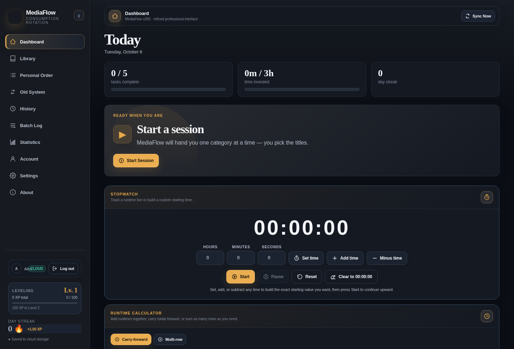
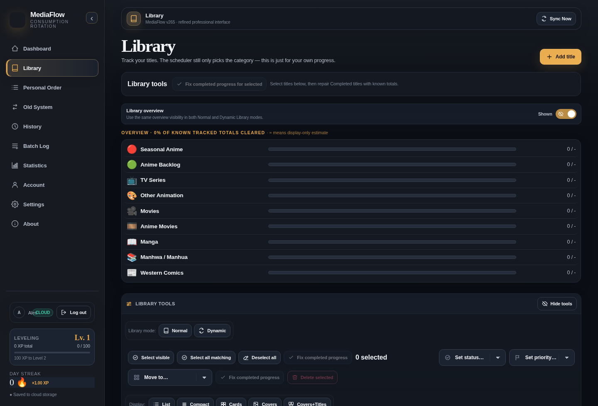
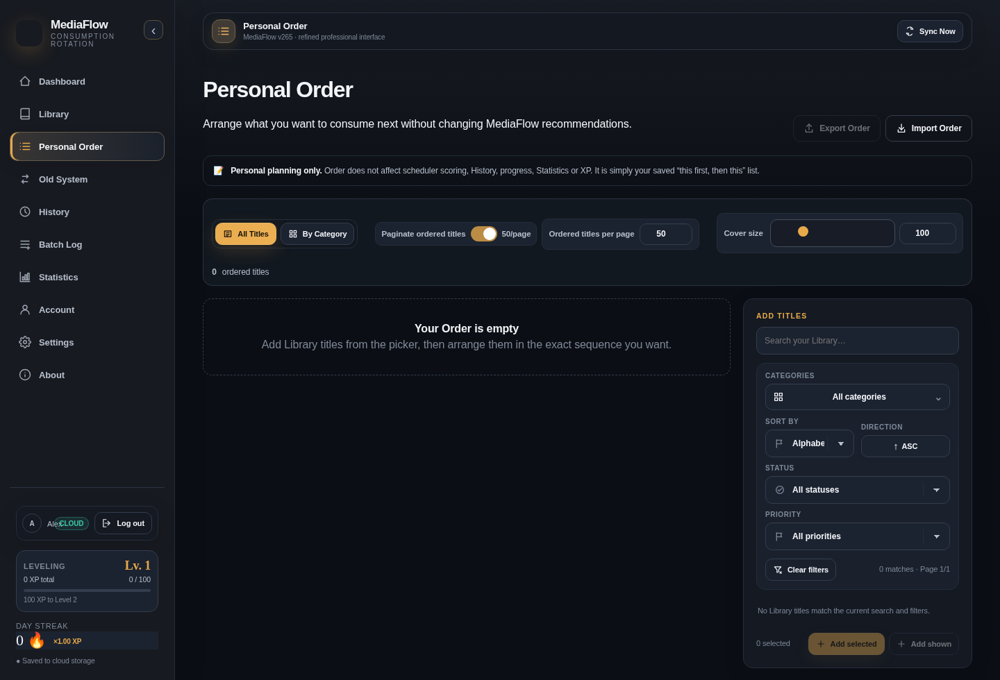
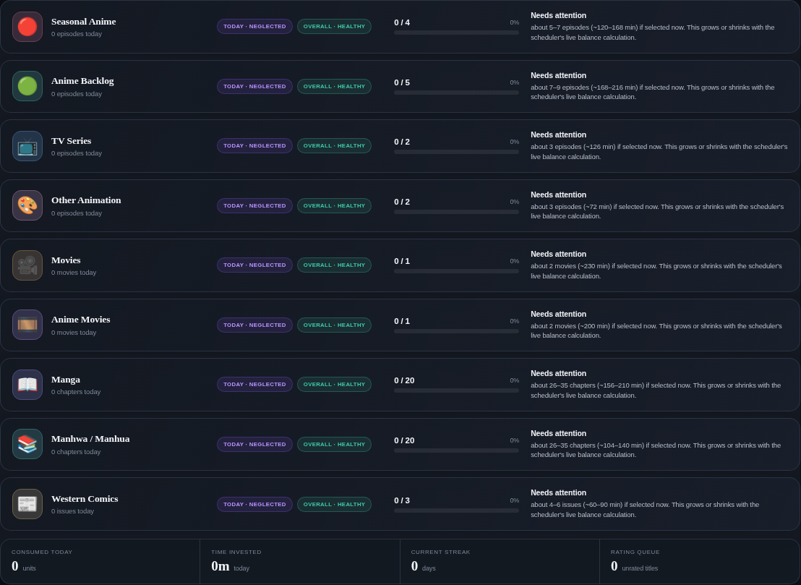

<div align="center">
  

# MediaFlow

**A personal home for everything worth watching, reading, and finishing.**

Organize a media library, plan what comes next, record consumption, and understand progress — on a workspace built around individual preferences rather than a fixed catalog.

[**Launch MediaFlow**](https://alexgodly.github.io/MediaFlow/) · [Getting started](#getting-started) · [Features](#features) · [How it works](#how-it-works) · [Evolution](#evolution)

**Web application · Installable PWA · Custom categories · Private account data · Import & export**
</div>

---

## At a glance

MediaFlow is a customizable media-management web application for anime, television, movies, manga, comics, books, and other formats. It combines a personal Library with consumption logging, scheduling, Collections, Personal Order, History, statistics, and account synchronization.

Most media trackers begin with a provider-defined catalog and a small set of tracking states. MediaFlow takes the opposite approach: **the Library belongs to its owner**. Categories, priorities, statuses, browsing views, visual themes, and much of the daily workflow can be tailored to fit a collection of any shape.

A title can be saved for later, organized into a Collection, positioned in a reading or watching queue, selected for a daily task, logged episode by episode, and revisited in History — without having to maintain a different list for every purpose.

| Built for | What it enables |
| --- | --- |
| **Personal organization** | One Library across different media formats and custom categories |
| **Intentional consumption** | Recommended next tasks, goals, and title suggestions |
| **Detailed tracking** | Quick Logging or itemized Advanced Logging with timestamps and runtime |
| **Flexible planning** | Collections and an individually organized Personal Order |
| **Progress insight** | History, statistics, levels, XP, streaks, and achievements |
| **Data portability** | Imports, exports, backup tools, and supported offline workflows |

> [!NOTE]
> MediaFlow is an evolving personal software project, not a streaming service or a source of hosted media. It organizes and tracks media information; it does not supply copyrighted video, books, or comics.

## Why MediaFlow?

**Different collections need different rules.** A manga series is measured in chapters, a television season in episodes, a book in pages, and a movie in completed viewings. MediaFlow supports category-specific units and separate approaches to progress, so the Library does not have to force everything into one tracking model.

**Planning and logging serve different purposes.** The Library records what exists and how far along it is. Personal Order determines what to approach next. Collections group related titles. Logging creates consumption records. History shows what happened. These tools work together without becoming the same thing.

**Customization is a core feature, not an afterthought.** Category order, popup controls, status and priority choices, display modes, sorting, cover sizes, text sizes, and dynamic themes can be adjusted to suit different screen sizes and habits.

**Large libraries deserve usable tools.** The interface includes indexed/paginated picker workflows and ongoing performance work aimed at collections containing tens of thousands of entries. Actual speed still depends on device resources, data size, and the selected operation.

**Information should remain portable.** MediaFlow provides import/export and backup workflows, local-state handling, and account-based cloud synchronization. Keeping an independent backup is recommended before large migrations or bulk changes.

## Features

### Library — the central catalog

- Add or edit media titles with category, status, priority, total units, current progress, rating, dates, cover artwork, and applicable metadata.
- Create and manage personal categories, with configurable units and category icons.
- Browse using **List, Compact, Cards, Covers, and Covers+Titles** display modes, where applicable.
- Search, filter, sort, and change layout preferences without permanently altering saved media information.
- Work with large libraries using pagination and purpose-built browsing controls.
- Track multiple seasons on supported titles, including season-specific progress.
- Use manual creation, supported import formats, and available metadata services instead of relying on one compulsory catalog.

### Dashboard — decide what comes next

The Dashboard combines daily planning with progress at a glance. Depending on current settings and data, it includes:

- A **Next Task** recommendation based on media categories and consumption goals.
- Recommended titles with saved progress and a description of the recommendation signals.
- Daily activity and progress summaries, including the Today’s Balance experience.
- A stopwatch and a runtime calculator for consumption planning.
- Library rating and missing-cover utilities.
- XP, level, streak, and other motivation-oriented summaries.
- A floating **Task Progress** display for the active Logging draft and an always-available **Quick Actions** menu on authenticated app views.

The recommendation system is a planning aid. Suggested titles and tasks do not automatically create consumption History.

### Logging — quick or detailed

**Quick Logging** records a consumed quantity with fewer steps. It suits short sessions and uncomplicated progress updates.

**Advanced Logging** supports three methods within the same unfinished draft:

| Method | Purpose |
| --- | --- |
| **Per Unit** | Add individual episodes, chapters, issues, or other units, each with its own date/time and duration |
| **Last Watched** | Express consumption through the most recently reached unit |
| **Amount Consumed** | Enter how many units were consumed in the session |

A title can have its own method, season selection, and runtime details. Switching methods does not immediately submit History or award XP. In v400, newly added **Per Unit** entries receive a timestamp at the moment that specific unit is logged; the bulk methods retain their own title-added defaults and editing fields.

Advanced Logging continues to use the existing unit-record pipeline, including progress safeguards and History submission. The floating Task Progress widget counts qualifying unsaved units for the **current task’s category**, rather than totals from unrelated categories.

### Collections — meaningful groups

Collections hold groups of titles organized around a franchise, theme, personal shortlist, project, or any other purpose. Browse and manage Collections independently, then add or remove titles through a searchable picker.

The **Add Titles** workspace offers Direct Add, Multi-Select, filtering, sorting, adjustable display modes, page-size controls, and responsive tools for desktop, tablet, and mobile.

### Personal Order — a queue with structure

Personal Order organizes titles and assigned Collections into a deliberate consumption sequence. Rather than relying exclusively on automatic recommendations, it provides a manually curated place to decide what matters next.

- Assign titles and Collections to selected categories.
- Reorder the queue using supported drag, arrow, and numeric-position controls.
- Browse with the same five visual modes used by the updated picker workspaces.
- Add titles quickly, individually or through Multi-Select, without deleting them from their original Library.
- Adjust search, filters, sorting, cover/text sizing, and page length in the relevant picker tools.

### History, statistics, and progression

- Review recorded consumption, individual units, session dates, and available runtimes.
- Filter and paginate History, and use supported export and management actions.
- Explore statistics built from stored Library and activity information.
- Track XP, levels, streaks, achievements, and related progress indicators.

History represents completed logging activity; simply selecting a title in a draft does not create a finalized record.

### Appearance, personalization, and accessibility

- Dynamic visual themes and supported custom color settings.
- Desktop, tablet, and mobile responsive layouts.
- Category-icon choices and configurable category/status/priority presentation.
- Multiple title browsing views, adjustable covers and text, and personalized filtering/sorting controls.
- Progressive Web App integration with update and diagnostics controls.
- Reduced-motion handling for supported animated components.

### Account data, sync, and backups

MediaFlow combines browser-side state with a Supabase-backed account system. The application includes cloud synchronization, local caching, manual and automatic backup tools, and supported data import/export formats.

Supported import workflows include manually supplied data from services such as MyAnimeList and SIMKL where the configured importers support those formats. **Live MAL/SIMKL account tracking and outgoing synchronization are not part of this release.**

> [!IMPORTANT]
> Offline editing and cached access are not a guarantee of offline sign-in or instant multi-device consistency. Local changes become available elsewhere only after a successful synchronization. Always keep an independent export before a major import, deletion, or migration.

## Getting started

### Open the hosted app

**[alexgodly.github.io/MediaFlow](https://alexgodly.github.io/MediaFlow/)**

1. Open MediaFlow in a modern browser.
2. Sign in or create an account through the configured authentication service.
3. Check the default categories and personalize them in **Settings**.
4. Add a few titles to the **Library**, or use an available importer.
5. Set statuses, priorities, totals, and progress.
6. Start a Logging session, review the updated Library and History, and use Personal Order and Collections to organize future consumption.
7. Use **Sync Now** to confirm synchronization and create a **Full Data backup** before large changes.

### Install as a PWA

Where the browser and operating system support installation, MediaFlow can be added to a home screen or installed as a standalone web app. Browser installation eligibility varies by platform and requires a suitable secure origin and PWA support. Check the app's installation/update settings and the browser's installation option.

The PWA is a presentation and caching layer for the same application; it does not constitute a separate offline cloud server.

### Run the packaged frontend locally

The repository contains prebuilt browser assets, so a local preview does not require compiling React or running a Node.js production server.

```bash
python -m http.server 8080
```

Open **http://localhost:8080/**. Local previewing is preferable to opening `index.html` directly with a `file://` URL, which restricts service workers and certain browser features.

A separately hosted installation needs its **own correctly configured Supabase authentication, database schema, and Row-Level Security policies** for cloud features. The source files alone are not a complete independent cloud deployment.

## How it works

### Build a collection of titles

Start in **Library**. Choose a Category, select a Status and Priority, and enter the available progress and total. The same title can later be found from logging, collection pickers, and Personal Order without being copied into separate standalone catalogs.

### Record a session

Open the Dashboard Logging workspace and select titles from the Library. Choose Quick Logging or Advanced Logging as appropriate. In Advanced Logging, select **Per Unit** to record individual consumption events; use **Last Watched** or **Amount Consumed** to enter a summary. Review dates, durations, and projected progress before submitting. The saved result becomes available in History.

### Build a Personal Order

Open **Personal Order**, choose a category, and add titles or existing Collections. Arrange them to match the preferred sequence. Manual ordering is separate from the default Library sort order.

### Use Collections

Create a Collection, open its title picker, and add a selection of Library entries. Direct Add provides individual add/remove actions; Multi-Select supports selecting several results. Views and page sizes can be adjusted without changing the original title records.

### Keep data recoverable

Use **Sync Now** after significant changes, especially when moving between devices. Export a complete backup before bulk edits or imports. A backup file is a separate recovery artifact; cloud sync alone should not be treated as the only backup strategy.

## Interface gallery

The screenshots below illustrate earlier stages of the current design system. Interface details have continued to evolve in later releases.

<details>
<summary><strong>View historical interface screenshots</strong></summary>

| Dashboard | Library |
| --- | --- |
|  |  |

| Personal Order | Dashboard balance |
| --- | --- |
|  |  |

</details>

## Technology and architecture

MediaFlow is delivered as a static web application with a modular JavaScript runtime and prebuilt interface assets. A React/TypeScript presentation layer coexists with the established JavaScript feature system; the main app is **not** exclusively a React single-page application.

| Layer | Technology / responsibility |
| --- | --- |
| Browser application | HTML, CSS, JavaScript |
| Interface assets | Prebuilt React-based UI layer, with TypeScript/Tailwind source history |
| Runtime build | Python source assembly, JavaScript syntax checks, release metadata generation |
| PWA | Web App Manifest and service worker |
| Identity and private account sync | Supabase authentication and configured database policies |
| Local experience | Browser storage/cache and supported offline workflows |
| Imports and exports | Supported JSON, CSV, XML, and service-specific formats where applicable |

### Project structure

```text
MediaFlow/
├── index.html                  # Application entry point
├── VERSION                     # Current release number
├── version.json                # Release and data-format metadata
├── manifest.json               # PWA installation metadata
├── sw.js                       # Release-aware service worker
├── assets/
│   ├── css/                    # Themes and responsive layouts
│   ├── js/                     # Versioned browser runtime and prebuilt UI
│   └── category-icons/         # Built-in category artwork
├── src/js/
│   ├── build-order.json        # Main source assembly order
│   ├── runtime-order.json      # Modular runtime extensions
│   ├── components/             # App UI and behavior extensions
│   ├── pages/                  # Page-specific rendering
│   └── services/               # Application services
├── scripts/                    # Builds, PWA tooling and regression checks
├── docs/                       # Release notes and technical documents
├── README.md                   # Public project documentation
└── README2.md                  # Release/technical companion notes
```

### Development and local validation

The primary app runtime is assembled using:

```bash
python scripts/build.py
python scripts/check.py
```

The build reads `src/js/build-order.json` and `src/js/runtime-order.json`, emits the versioned JavaScript bundle, and refreshes the local PWA files. Node.js is used for syntax validation where available. The optional Vite/React UI toolchain is not interchangeable with the full modular runtime builder.

Changes affecting cloud data require extra validation against the target backend. Browser-only regression checks do not establish that authenticated cloud sync, conflict recovery, or physical-device behavior works correctly in production.

## Privacy, data ownership, and limitations

- MediaFlow account synchronization depends on the configured Supabase backend, authentication state, and database access policies.
- The browser may retain local state and unfinished drafts; that data should be protected like other personal account information.
- Independent exports are recommended for recovery and migration.
- Remote cover URLs and third-party media metadata can change or become unavailable.
- Browser/PWA installation and offline capabilities vary by device and platform.
- Very large libraries, high page-size settings, and cover-heavy grids can consume substantial memory; responsiveness is not guaranteed on every device.
- The discontinued Community/social experiments and canceled MAL/SIMKL account-tracking experiment are **not active features** of this release.

## Fun facts

- **A deliberately broad Library.** MediaFlow was designed around a mixed media catalog, not just anime or TV series.
- **Categories are user-defined.** The same tracking engine can work with episodes, chapters, pages, and other category-specific units.
- **Four hundred as a milestone.** v400 marks the release's move toward independent event timestamps, consistent picker workspaces, and a long-lived public README.
- **Five ways to browse.** List, Compact, Cards, Covers, and Covers+Titles serve different workflows, from dense searching to poster-first browsing.
- **Planning is separate from activity.** Adding a title to Personal Order or a Collection does not create a watched/read History event.
- **Built to be portable.** A static frontend, modular source organization, an installable PWA layer, and export tools provide several ways to use and maintain a personal media workspace.

## Evolution

The generations below describe real shifts in MediaFlow's architecture and direction. They are historical groupings, not separate products.

<!-- MEDIAFLOW_EVOLUTION_START: update this section only in future releases -->

| Generation | Versions | Major direction |
| --- | --- | --- |
| **01 — Origins** | v1–v83 | The first personal tracking experiments and core Library workflows |
| **02 — Tracking foundations** | v84–v118 | Reliability, core tracking behavior, and a more recognizable themed interface |
| **03 — Planning and progression** | v119–v201 | Personal workflows, XP, imports, scheduling, and richer customization |
| **04 — Modular foundation** | v202–v243 | Organized runtime source, Library refinements, and large-catalog usability |
| **05 — Installable and seasonal** | v244–v259 | PWA infrastructure, season progress, cover overlays, and Dashboard utilities |
| **06 — Modern interface** | v260–v301 | Refined visual system, Collections, responsive design, and stronger personal data workflows |
| **07 — Community research** | v302–v329 | Public-platform experimentation; Community functionality subsequently put on hold |
| **08 — Personal Edition reset** | v330 | A deliberate return to personal tracking and controlled complexity |
| **09 — Data and workflow depth** | v331–v364 | Backend hardening, responsive pickers, XP, and expanded personal tools |
| **10 — Logging and settings** | v365–v373 | Settings Center 2.0, performance work, and increasingly detailed Logging |
| **11 — Tracking experiment rollback** | v374–v375 | Canceled external account-tracking experiment and restored personal baseline |
| **12 — Personal Order unification** | v376 | Personal Order picker and organization improvements |
| **13 — Workflow and stability refinement** | v377–v394 | Media metadata, reliable search, large-Library performance, picker interactions, and Advanced Logging |
| **14 — Responsive workspace milestone** | v395–v400 | Dashboard recommendations, floating task tools, responsive pickers, and per-unit timestamp independence |
| **15 — Verified seasonal intelligence** | v401 | Multi-provider episode verification, per-title evidence, and fresh-only Seasonal Anime recommendations |
| **16 — Seasonal accuracy & data protection** | v402–v403 | Cross-provider MAL matching, highest verified Fresh Episodes selection, Unknown-safe recommendations, cloud/export integrity, PWA reliability, and confidence-qualified airing evidence |
| **17 — The Smart Engine & refinement** | v404 | Official engine branding, repaired synchronized recommendation settings, non-blocking toggle path, progress-aware eligibility, and refreshed About FAQ/Fun Facts |
| **18 — Data integrity & experience** | v405 | Floating-control preferences and mobile More overlay safety; verified cloud/backup/preset transfer fields, refreshed release stamps, PWA app-shell, and the “intelligent era” Evolution chapter |

### Recent milestones

| Version | Highlight | Notes |
| --- | --- | --- |
| **v405** | Independent floating Quick Add and Task Progress visibility settings; fixed mobile More layering; updated About Evolution; current cloud/export and PWA contracts | [Release notes](docs/CHANGELOG_v405.md) |
| **v404** | Alex Godly's Smart Fresh Episodes Engine branding; canonical Dashboard fresh-only switch; responsive toggle and chunked task refresh; new FAQ and developer-history Fun Facts | [Release notes](docs/CHANGELOG_v404.md) |
| **v403** | Single-source AniList schedule verification for caught-up titles, reducing false Unknown results and enabling certified aggregate updates | [Release notes](docs/CHANGELOG_v403.md) |
| **v402** | Automatic 2 identity and highest verified fresh counts; Unknown-eligible recommendations; cloud/backup parity, import/export safeguards and PWA reliability | [Release notes](docs/CHANGELOG_v402.md) |
| **v401** | Automatic Multi-Provider 2; five-provider per-title verification and optional fresh-only Seasonal Anime recommendations | [Release notes](docs/CHANGELOG_v401.md) |
| v400 | Independent Per Unit timestamps, unified Add Titles workspace, responsive picker tools, README refresh | [Release notes](docs/CHANGELOG_v400.md) |
| v399 | Personal Order and Collections picker workspace overhaul | [Release notes](docs/CHANGELOG_v399.md) |
| v398 | Mobile and tablet interface repairs | [Release notes](docs/CHANGELOG_v398.md) |
| v397 | Floating Task Progress and quick actions | [Release notes](docs/CHANGELOG_v397.md) |
| v396 | Advanced Logging progress and ordering reliability | [Release notes](docs/CHANGELOG_v396.md) |
| v395 | Recommended Title visual redesign and logging improvements | [Release notes](docs/CHANGELOG_v395.md) |
| v394 | Advanced Logging: Per Unit, Last Watched, Amount Consumed | [Release notes](docs/CHANGELOG_v394.md) |
| v393 | Picker scrolling stability and reversible Add/Added | [Release notes](docs/CHANGELOG_v393.md) |
| v392 | Collections and Personal Order Direct Add / Multi-Select | [Release notes](docs/CHANGELOG_v392.md) |
| v391 | Performance and History layout work | [Release notes](docs/CHANGELOG_v391.md) |

Earlier generations are documented through available historical release notes in [`docs/`](docs/). Not every early version has a separate preserved changelog.

<!-- MEDIAFLOW_EVOLUTION_END -->

## Frequently asked questions

<details>
<summary><strong>Can MediaFlow track more than anime?</strong></summary>

Yes. The Library uses customizable categories with category-specific progress units, making it suitable for many kinds of media.

</details>

<details>
<summary><strong>Is a Library title the same as a logged session?</strong></summary>

No. A Library entry describes the title and its saved state. Logging records consumption activity; a completed submission creates History.

</details>

<details>
<summary><strong>Can title progress be tracked by season?</strong></summary>

Supported titles can contain editable season information, and Advanced Logging can work with unit entries associated with the selected season.

</details>

<details>
<summary><strong>Does MediaFlow stream or host media?</strong></summary>

No. It manages personal media information and activity; playback or access to media takes place through other services or sources.

</details>

<details>
<summary><strong>Will changes automatically appear on another device?</strong></summary>

Only after they synchronize successfully. Local caching and offline editing do not guarantee that another device already has the latest state.

</details>

<details>
<summary><strong>Does installing the PWA create a separate account or Library?</strong></summary>

No. An installed PWA is another presentation of the same web application. Account and synchronization behavior depend on the configured backend and current signed-in state.

</details>

<details>
<summary><strong>Is this repository open source?</strong></summary>

The repository includes source code, but the project is distributed under the included **MediaFlow Proprietary License**. Source availability does not imply an open-source license. See [`LICENSE`](LICENSE) for permitted uses and restrictions.

</details>

## Project and credits

**MediaFlow** is designed and developed by **Alex Godly**.

- **Project:** [MediaFlow](https://alexgodly.github.io/MediaFlow/)
- **Developer:** Alex Godly
- **License:** [MediaFlow Proprietary License](LICENSE)
- **Detailed history and technical notes:** [`docs/`](docs/) · [`README2.md`](README2.md)

MediaFlow is an independent personal project. Third-party trademarks, poster images, metadata, and service names belong to their respective owners.

---

<div align="center"><sub>MediaFlow · A personal media workspace built to evolve.</sub></div>
