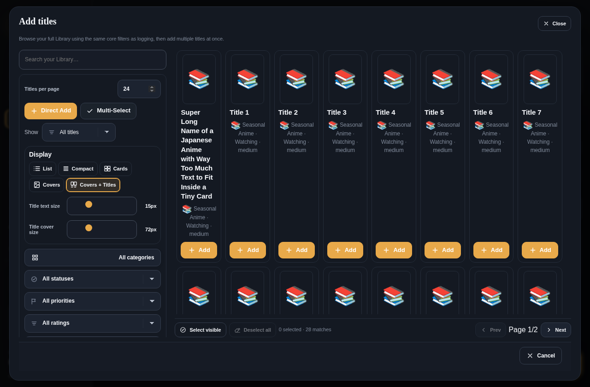
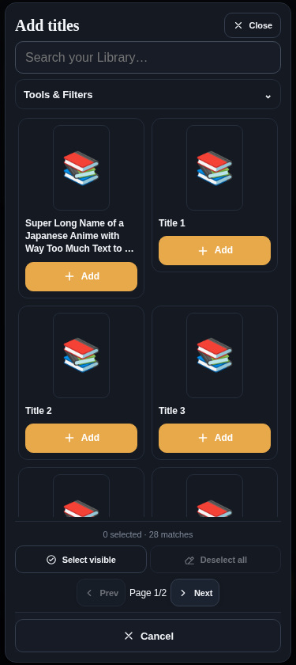

<h1>MediaFlow</h1>

<strong>by Alex Godly</strong>

<strong>Your media. Your collection. Your flow.</strong>

A thoughtfully designed home for everything you watch, read, discover, and remember.

<a href="https://alexgodly.github.io/MediaFlow/"><strong>Launch MediaFlow ↗</strong></a> &nbsp;•&nbsp; <a href="https://github.com/AlexGodly/MediaFlow/releases/latest"><strong>Latest Release</strong></a> &nbsp;•&nbsp; <a href="#inside-mediaflow"><strong>Explore Features</strong></a>

---

## A better way to experience your media

**MediaFlow by Alex Godly** is a personal media-management workspace built to bring your entertainment universe into one place. Whether you're following seasonal anime, catching up on TV, working through a film watchlist, or reading manga, comics, and books, MediaFlow gives each title a home—and gives you a clearer picture of your journey.

More than a conventional tracker, MediaFlow connects your **Library**, **recommendations**, **consumption logging**, **personal priorities**, **collections**, and **statistics** in a customizable interface that works across devices.

> **Organize what you love. Know where you left off. Find what comes next.**

## Inside MediaFlow

<table>
<tr>
<td width="50%" valign="top">
<h3>📚 A library for everything</h3>

Keep anime, TV series, movies, manga, manhwa, comics, books, novels, and other media together. Manage statuses, priorities, ratings, covers, rich title details, episode/chapter progress, and custom categories. Choose the Library view that feels right for you.

</td>
<td width="50%" valign="top">
<h3>✨ Recommendations with purpose</h3>

Turn an overwhelming backlog into a more meaningful next choice. MediaFlow's Dashboard brings together personal recommendations, category balancing, priorities, and progress-aware tools to help you decide what to experience next.

</td>
</tr>
<tr>
<td valign="top">
<h3>⏱️ Logging built around real progress</h3>

Record watching and reading through flexible logging methods—including individual episodes or chapters, latest progress, and amount consumed. Keep a history of your sessions, timestamps, progress, and estimated time spent.

</td>
<td valign="top">
<h3>🗂️ Collections & Personal Order</h3>

Create curated collections for any theme, franchise, or goal. Keep a separate <strong>Personal Order</strong> for the titles you want to experience in your own sequence, with organization tools designed for large libraries.

</td>
</tr>
<tr>
<td valign="top">
<h3>📊 Your story, in statistics</h3>

Explore consumption history, category activity, progress, trends, milestones, and other insights. Built-in XP, leveling, and streak features add an optional layer of motivation to your media routine.

</td>
<td valign="top">
<h3>🎨 An experience that feels yours</h3>

Personalize MediaFlow with themes, cover-driven visual styling, configurable views, category icons, layout controls, and a responsive interface built for desktop, tablet, and mobile.

</td>
</tr>
</table>

## Go beyond the basics

- **Fresh-release intelligence:** Provider-assisted checks, title recommendations, and **Alex Godly's Smart Fresh Episodes Engine** help surface relevant new episodes when compatible sources provide usable evidence.
- **Artwork and metadata recovery:** Tools to discover missing covers or metadata, review candidates, and apply selected changes while respecting existing information. Availability varies by provider and configuration.
- **Import, export & portability:** Bring in supported data formats and compatible tracking-service exports, back up account data, and move or restore your MediaFlow workspace.
- **Powerful organization:** Search, sorting, filters, bulk actions, collections, customizable category systems, and multiple display modes support even extensive libraries.
- **Integrated utilities:** A stopwatch, runtime calculator, progress tools, and configurable settings help make MediaFlow useful beyond simple title checklists.

## Designed to go with you

MediaFlow is delivered as a **Progressive Web App (PWA)**, combining the simplicity of a website with an app-style experience.

| | |
| :-- | :-- |
| **Web** | Open MediaFlow in a modern browser—no traditional installation required. |
| **Installable** | Add it to a supported device's home screen or install it as a standalone app where your browser supports PWAs. |
| **Responsive** | Interfaces adapt to desktop, tablet, and smaller phone screens. |
| **Cloud-connected** | Account data is synchronized through Supabase using MediaFlow's existing cloud-save system. |
| **Offline-aware** | The PWA can cache app resources; cloud synchronization and provider-based features still require connectivity. |

## Get started

1. **[Open MediaFlow](https://alexgodly.github.io/MediaFlow/)** and sign in to your workspace.
2. **Build your Library:** add titles manually or use a supported import option.
3. **Make it your own:** configure categories, statuses, display modes, and appearance.
4. **Start tracking:** log episodes, chapters, or other progress and explore the Dashboard and Statistics.
5. **Organize what comes next:** create Collections and build your Personal Order.

You can use MediaFlow directly in the browser or install it as a PWA through your browser's supported install controls.

## A glimpse of MediaFlow

<small>Desktop workspace preview</small>

  

 
<small>Mobile interface preview · Illustrative screenshots from an earlier build; layouts continue to evolve.</small>

## Made for a personal universe of media

MediaFlow is built around a simple idea: **your media experience should follow your preferences, not force you into someone else's system.**

It is a media **organization and tracking** application—not a streaming, reading, or content-hosting service. Artwork, metadata, and external provider information may depend on third-party availability and their respective terms.

## Project & resources

| Resource | Link |
| :-- | :-- |
| **Live application** | [alexgodly.github.io/MediaFlow](https://alexgodly.github.io/MediaFlow/) |
| **Current releases** | [GitHub Releases](https://github.com/AlexGodly/MediaFlow/releases) |
| **Project documentation** | [Documentation directory](docs/) |
| **Architecture** | [Architecture notes](docs/ARCHITECTURE.md) |
| **License** | [MediaFlow Proprietary License](LICENSE) |

### Technology

MediaFlow combines a browser-based application and PWA architecture with JavaScript, responsive styling, client-side persistence, a Supabase-backed cloud workspace, and external metadata integrations. Its interface and tooling continue to evolve across numbered releases.

### License & ownership

**MediaFlow is proprietary software.** Its source code and original assets are **not open source** merely because this repository is visible. All rights are reserved, and use, modification, redistribution, or derivative works are governed by the [MediaFlow Proprietary License](LICENSE).

---

<strong>MediaFlow by Alex Godly</strong>

<em>Organize the journey. Enjoy the experience.</em>

© 2026 Alex Godly. All rights reserved.

<a href="https://alexgodly.github.io/MediaFlow/">Launch MediaFlow</a> · <a href="https://github.com/AlexGodly/MediaFlow/releases">Releases</a> · <a href="LICENSE">License</a>

