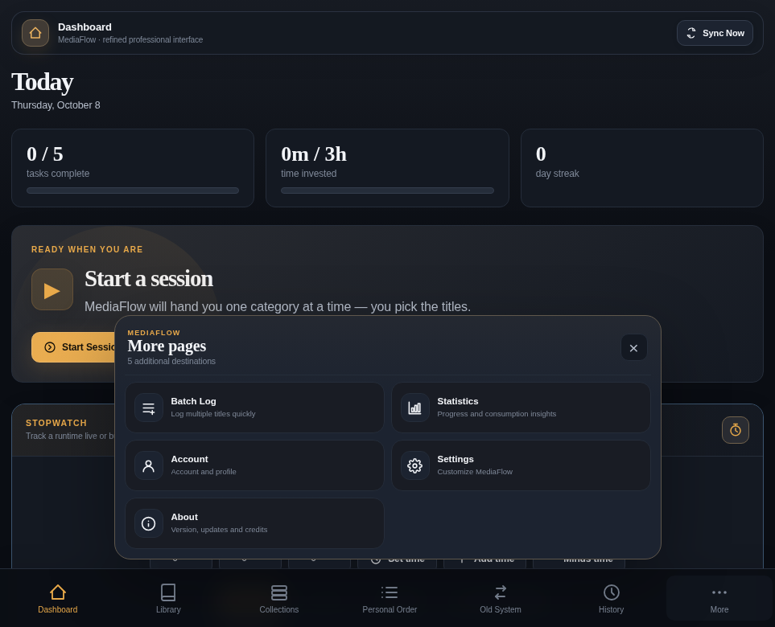

# MediaFlow v387 — Added Titles Ordering Scroll Stability

**Latest modular candidate:** v387 · October 12, 2026  
**Developer/owner:** Alex Godly  
**Baseline:** v386 Modular  
**Delivery:** Complete modular ZIP for local testing; no GitHub actions.  
**Release notes:** [README2.md](./README2.md) · [Detailed v387 changelog](./docs/CHANGELOG_v387.md)

**What's fixed:** Reordering Added Titles in **Quick Logging** or **Per Unit** now keeps the user's scroll position stable through arrow moves, numeric positions, drag/custom moves, and sorting changes. The v373 ordering renderer no longer pointlessly detaches every title card, and a lightweight v387 viewport/focus guard also supports nested scrollers and numeric inputs.

**Validation:** Controlled Chromium tests passed at 320, 390, 820, 1280 and 1920 px in both modes, including 20 consecutive movements and unchanged-order mutation checks. Production-account, touch-device and authenticated cloud testing remain outstanding. No XP, History, data schema or Logging draft format changed.

---

# MediaFlow v386 — Logging Browse Library Real-Theme Color Repair

**Latest modular candidate:** v386 · October 11, 2026  
**Developer/owner:** Alex Godly  
**Baseline:** v385 Modular  
**Delivery:** Modular ZIP for local testing; no GitHub actions.  
**Release notes:** [README2.md](./README2.md) · [Detailed v386 changelog](./docs/CHANGELOG_v386.md)

**Confirmed source defect:** The v383–v385 Library color styles used `--accent`, which is undefined under many MediaFlow themes. The normal user-customizable color variable is `--flow`. v386 fixes this locally in the Library component, colors both collapsed and expanded surfaces, and replaces older misleading tests with actual renderer, real-theme, and screenshot-pixel verification. No data or XP formulas changed.

**Validation:** Chromium passes at 320, 390, 820, 1280 and 1920 px in Quick and Per Unit. The ZIP includes blue-theme desktop/mobile screenshots. Cloud and installed-PWA updates were not verified live.

---

# MediaFlow v385 — Live Leveling, Full-Color Logging Library & About Alignment

**Latest modular candidate:** v385 · October 11, 2026  
**Developer/owner:** Alex Godly  
**Baseline:** v384 Modular  
**Delivery:** Modular ZIP for local testing, no GitHub commit, push or deployment.  
**Release notes:** [README2.md](./README2.md) · [Detailed v385 changelog](./docs/CHANGELOG_v385.md)

v385 extends the theme color across **both the collapsed header and expanded Logging Library workspace**, optically aligns the official About logo with the wordmark, and makes the sidebar and Statistics XP/level/streak indicators update automatically from the same cached values. Cloud save status no longer claims success before a confirmed save. No XP formulas or cloud data schemas are changed.

**Validation:** Real Chromium UI checks passed at five screen widths, including live XP updates and simulated cloud save outcomes. Authenticated Supabase, real-account performance and installed-PWA upgrades remain unverified.

---


# MediaFlow

**Personal media management, tracking, planning, and analytics — by Alex Godly.**

[](./VERSION)


> **MediaFlow v387 (built on v386 Modular).** Organize anime, manga, manhwa, manhua, films, TV, books, novels, comics, and other media; record itemized or quick consumption; plan your next titles; and analyze your activity. v374 provider account tracking was canceled.

**Website:** https://alexgodly.github.io/MediaFlow/  
**Repository:** https://github.com/AlexGodly/MediaFlow  
**Creator:** Alex Godly  
**Current packaged candidate:** v387 · October 12, 2026, built on v386 Modular. **GitHub:** v387 has not been committed, pushed, or deployed by this release workflow. **Live website:** not independently verified.

> **Development lineage:** v330 historically restored the v301 personal application after the v302–v329 Community experiment. Personal development subsequently continued through v373. **v374** introduced experimental MAL/SIMKL account tracking, and **v375** restored v373 instead of keeping that experiment. Community/public social features remain excluded from the v387 release.

**v387 changelog:** [README2.md](./README2.md), [detailed v387 changelog](./docs/CHANGELOG_v387.md). **Prior v386 notes:** [docs/CHANGELOG_v386.md](./docs/CHANGELOG_v386.md). **Prior v385 notes:** [docs/CHANGELOG_v385.md](./docs/CHANGELOG_v385.md). **Prior v384 notes:** [docs/CHANGELOG_v384.md](./docs/CHANGELOG_v384.md). **Prior v383 notes:** [docs/CHANGELOG_v383.md](./docs/CHANGELOG_v383.md). **Prior v382 notes:** [docs/CHANGELOG_v382.md](./docs/CHANGELOG_v382.md). **Prior v381 notes:** [docs/CHANGELOG_v381.md](./docs/CHANGELOG_v381.md). **Prior v380 notes:** [docs/CHANGELOG_v380.md](./docs/CHANGELOG_v380.md). **Prior v379 notes:** [docs/CHANGELOG_v379.md](./docs/CHANGELOG_v379.md). **Prior v378 notes:** [docs/CHANGELOG_v378.md](./docs/CHANGELOG_v378.md). **Prior v376 notes:** [docs/CHANGELOG_v376.md](./docs/CHANGELOG_v376.md). **Earlier baseline notes:** [v373 Logging Sorting](./docs/CHANGELOG_v373.md), [v372 Logging UI 3.0](./docs/CHANGELOG_v372.md), [v369 Itemized Logging](./docs/CHANGELOG_v369.md), and the [v375 rollback summary](#release-v375--technical-changelog). Historical release notes retain the version labels under which their changes originally shipped.

---

## Contents

1. [Overview](#overview)
2. [Release status and development direction](#release-status-and-development-direction)
3. [Feature overview](#feature-overview)
4. [Supported media and categories](#supported-media-and-categories)
5. [Getting started](#getting-started)
6. [How to use MediaFlow](#how-to-use-mediaflow)
7. [Installation and deployment](#installation-and-deployment)
8. [Technologies and programming languages](#technologies-and-programming-languages)
9. [Architecture and project structure](#architecture-and-project-structure)
10. [Data model, synchronization, and backups](#data-model-synchronization-and-backups)
11. [Configuration and development](#configuration-and-development)
12. [Compatibility, limitations, and troubleshooting](#compatibility-limitations-and-troubleshooting)
13. [Release v377 — technical changelog](#release-v377--technical-changelog)
14. [Release v376 — technical changelog](#release-v376--technical-changelog)
15. [Release v375 — historical rollback](#release-v375--technical-changelog)
16. [Historical release v330 — technical changelog](#historical-release-v330--technical-changelog)
17. [The complete MediaFlow evolution](#the-complete-mediaflow-evolution)
18. [Project roadmap and Community hiatus](#project-roadmap-and-community-hiatus)
19. [Project ownership and contact](#project-ownership-and-contact)

---

## Overview

MediaFlow is a personal media workspace built to unify **collection management, progress tracking, viewing/reading schedules, consumption records, recommendations, and analytics**. Instead of maintaining separate trackers for different types of entertainment, the application organizes them under customizable Categories, statuses, priorities, and personal workflows.

The application is intended to support a large and diverse Library. It provides compact and cover-focused views, fine-grained filters, personalized ordering, fast logging, backup/export tools, cloud synchronization, and a responsive interface. Several performance improvements across its development history specifically target Libraries containing tens of thousands of titles; **50,000 titles is an engineering target, not a published guarantee for every device**.

### At a glance

| Area | What MediaFlow provides |
| --- | --- |
| **Library** | Add, edit, organize, search, sort, filter, rate, and track media titles |
| **Dashboard** | Recommendations, activity indicators, rerolls, shortcuts, stopwatch, and runtime calculator |
| **Personal Order** | Plan consumption using ordered titles, Categories, and Collection queues |
| **Logging & Batch Log** | Per unit entries with editable timestamps/durations, Quick Logging, batch workflows, and customizable session ordering |
| **History** | Consumption records, recent activity, ratings, previous Library activity, and export controls |
| **Statistics** | Completion, time, media mix, activity trends, XP, streaks, and other personal insights |
| **Collections** | Curate groups of existing Library titles with multiple browsing modes |
| **Old System** | Maintain the application's earlier category-balance and conversion workflow |
| **Account & Settings** | Settings Center 2.0, searchable settings, personal appearance, categories, XP preferences, cloud protection, backups, and updates |
| **Platform** | Responsive website and installable Progressive Web App where supported |

### Interface previews

These are screenshots retained from earlier personal releases. They illustrate the project, **not necessarily the current v377 UI** or a particular theme.

| Dashboard | Library |
| --- | --- |
|  |  |

| Personal Order | Responsive More navigation |
| --- | --- |
|  |  |

---

## Release status and development direction

### Current local candidate: v377 (editable IDs, Jikan recovery, Personal Order refinement)

v377 is the latest packaged **local development candidate**. It builds directly on the complete v376 Personal Edition module tree and improves Jikan reliability, external identifier editing, and the Personal Order position controls. No GitHub push or deployment was performed; the owner will manage repository history. The canceled v374 tracking branch remains excluded.

| Area | v377 current candidate |
| --- | --- |
| Application feature baseline | **v373**: Advanced Logging Sorting & Custom Order Studio |
| Logging presentation | **v372**: Logging Interface 3.0, building on v369–v371 |
| Settings | **v365–v367** Settings Center 2.0 and stability/registration improvements |
| Community / public social systems | Historical v302–v329 research; **not part of v377** |
| MAL/SIMKL authenticated account tracking | **Canceled v374 experiment; excluded from v377** |
| MAL/SIMKL file/data imports | Existing import workflows retained where supported; **distinct from account tracking** |
| Database | Existing private MediaFlow cloud-state system; v374 tracking tables removed |
| Legacy tracking Edge Function | Old implementation disabled and configured to return HTTP 410; permanent deletion and provider-secret removal not confirmed |
| Production verification | v377 local JS/PWA rebuild, mocked Jikan and Chromium UI checks passed; authenticated cross-device testing, live Jikan, Pages/PWA deployment, and physical-device checks remain outstanding |

**Historical v375 release-asset mismatch (resolved in v376 candidate):** v375 had metadata version 375 but v373-named runtime and PWA assets. v376 has its own rebuilt `mediaflow-v376.bundle.js`, `sw.js` cache and consistent version metadata. Production verification remains pending.

### Historical personal / Community branches

- **v301 → v330:** v330 was a version-only restoration of the v301 personal application, not an inclusion of the v302–v329 Community features.
- **v331–v373:** Subsequent Personal Edition development introduced new backend configuration, time/XP analytics, mobile UX, Collections/Personal Order workflows, Settings Center 2.0, and itemized/advanced Logging.
- **v374:** Experimental, optional MAL/SIMKL OAuth tracking integration; later canceled.
- **v375:** Return to the v373 application, with the canceled tracking tables removed and tracking execution disabled server-side.

### Why Community remains on hold

The experimental Community branch explored public profiles, social relationships, discovery, shared Collections, public rankings, ratings, and cross-user analytics. Providing these as a reliable service requires adequate hosting, secure data access, operational monitoring, performance, bandwidth, and sustainable maintenance resources.

The current direction is a **high-quality personal workspace**. A future Community revival is not scheduled or promised. Community functionality is **not** a runtime dependency of v377.

## Feature overview

### 1. Dashboard and recommendations

The Dashboard brings frequently used information and actions into one workspace:

- Personalized recommendations selected from eligible Library entries.
- Current recommendation with cover artwork, title details, and quick logging/opening actions.
- Recommendation rerolls with history, selection controls, and **Respect**-related information.
- Title progress and current media status where applicable.
- Activity and progression indicators such as XP, Level, streak, and personal balance insights.
- **On This Day** views and historical consumption highlights when enabled.
- **Rate Your Library** and **Missing Covers** workflows for maintaining data quality.
- A **Stopwatch** and **Runtime Calculator**, with settings to show or hide the available Dashboard utilities.

**Historical note:** v301/v330 repaired Current Rerolls dialog scrolling. Later releases built on these personal features; v375 also retains the v334 Dashboard/XP changes and subsequent refinements.

### 2. Library management

A centralized home for media entries, whether currently consumed, planned, paused, completed, or dropped.

- Add and edit titles and their metadata.
- Assign Category, Status, Priority, rating, and progress.
- Store title cover URLs and available imported identifiers/details.
- Search, sort, filter, and paginate large lists.
- Use **Normal** and **Dynamic** Library layouts.
- Switch among **List**, **Compact**, **Cards**, **Covers**, and **Covers+Titles** views.
- Filter by Category, Status, Priority, rating, and available/missing cover as supported by the selected view.
- Customize cover dimensions and eligible cover overlays (Category, Status, rating, progress bar).
- Inspect Title Details, update progress, and use bulk-management controls.
- Use Library-history and deleted-title recovery facilities where available.

**Seasons View:** supported titles can contain individual season names/numbers, progress, and total units. Aggregate progress and season-aware logging are available in the corresponding editors.

### 3. Custom Categories, statuses, and priorities

Categories define how your own Library is organized. MediaFlow does not require everyone to use a universal category taxonomy.

- Create, rename, reorder, enable/disable, and customize Categories.
- Choose a built-in MediaFlow Category icon, supported image URL, or emoji.
- Configure Category colors and relevant media settings (such as tracking units, minutes per unit, targets, and weights).
- Recover missing default Categories or restore the most recently deleted Category through designed confirmation dialogs.
- Reorder and adjust the visibility of relevant Category, Status, and Priority controls in Settings.
- Use the same Categories across Library, Personal Order, History, statistics, and logging.

### 4. Media logging, itemized sessions, and Batch Log

Logging records actual consumption—episodes watched, chapters read, issues consumed, time spent, or other Category-defined units—and remains distinct from adding titles to the Library.

- **Per unit Logging (v369):** record episode/chapter/issue entries individually with editable date, time (including seconds), and runtime; support season-aware units, rewatches/rereads, contiguous-progress safeguards, and existing XP rules.
- **Quick Logging:** use **Amount Consumed** or **Last Progress** while retaining the established workflow.
- **Logging Interface 3.0 (v372):** theme-native selected-title panels, cover artwork, badges, richer session presentation, and responsive controls.
- **Arrange Your Session (v373):** first-added-first-displayed order by default; sort by session addition, progress, total units, priority, alphabetical title, recent logging, edit/view dates, Library date added, or random order. Switch direction, reshuffle, or keep a persistent manual arrangement.
- **Manual ordering:** drag titles, move them with up/down controls, or enter numeric positions without changing the global Library sequence.
- **Across all Logging workflows:** the same selected-title organization works in Per unit, Quick Amount Consumed, and Quick Last Progress modes.
- **Batch Log and History:** work across multiple titles, filter available Library items, and review/edit supported consumption records.

These features are part of the **v373 baseline preserved by v375**. They do **not** require MAL or SIMKL account connections.

### 5. Personal Order and planning

Personal Order provides structured control over what to consume next.

- Create an ordered queue across Categories and individual titles.
- Assign priorities and reorder using supported manual and numeric position controls.
- Use title/Category views and available sorting or filtering controls.
- Add existing **Collections as live queue references**, including mixed queues of direct titles and Collection blocks.
- Configure eligible Collection behavior (such as matching the task Category and handling completed titles).
- Advance a Collection queue as recommended titles are actually logged.
- Open assigned Collections directly and inspect their live title lists.
- Import and export supported Personal Order data (format **v5**).

### 6. Collections

Collections are curated groups of existing Library entries, not a second global catalog.

- Create, edit, describe, and organize personal Collections.
- Set custom covers or use available automatic cover collages.
- Browse Collections in different supported views, including cover- and card-oriented layouts.
- Search, sort, filter, and adjust cover sizes for Collection contents.
- Inspect Collection progress and completion information.
- Assign Collections to Personal Order when desired.
- Transfer Collections using the supported **v2** import/export format.

**Personal Edition (v376):** Community publishing, subscriptions, and public Collection discovery experiments are not part of the active personal application.

### 7. History and activity review

The unified History interface brings related activity views together. Depending on the selected tab, users can inspect:

- **Consumption History:** time-grouped records and activity summaries.
- **Recently Viewed:** recent title activity based on available timestamps.
- **Ratings:** title-rating activity.
- **Logs:** a more traditional paginated session log with filters, selection, editing, and export.
- **Library:** the Library's historical changes and supported recovery information.

Available controls include date and Category filters, pagination, custom range selections, CSV exports, title artwork, and batch-selection tools. Historical entries are personal account data, not a public social feed.

### 8. Statistics, progression, and achievements

MediaFlow can analyze the data already recorded in your Library and History:

- Library breakdowns by Category and Status.
- Progress, completed titles, and consumption volume.
- Ratings and selected title metrics.
- Tracked time and relevant historical trends.
- Monthly recaps, activity heatmaps, and completion timelines.
- XP, Level, streak, achievements, and supported reward configuration.
- Category balance and activity insights.

Some metrics rely on accurate manual logging, configured tracking units, or imported metadata; they should not be mistaken for externally verified watch/read history.

### 9. Old System

The Old System preserves an earlier MediaFlow workflow for Category-based management and consumption conversions. It includes **System**, **View**, and **Stats** modes and retains its underlying personal data and settings. It exists alongside the current Library, Order, and History experiences for continuity with older workflows.

### 10. Appearance, customization, and accessibility

- **Settings Center 2.0 (v365–v367):** responsive Settings home/category browser, contextual search, automatic/declarative settings registration, and stable initial render.
- Theme collections with dark, light, and other supported appearance modes.
- Cover-driven dynamic themes and Full Style themes.
- Theme-aware cards, typography, modal dialogs, navigation, and controls.
- Customizable Category icons and colors.
- Responsive desktop, tablet, and phone navigation; compact mobile layouts.
- Adjustable cover sizes and relevant view preferences.
- Keyboard-focused and touch-friendly interactions in supported dialogs.
- Settings search and organized Settings navigation.
- Responsive **More** navigation at smaller widths.

### 11. Cloud Sync, offline workflows, and exports

- Account-based synchronization with Supabase.
- Local application cache and supported offline workflows.
- Explicit **Sync Now** controls and cloud-state verification/protection routines.
- Full Data export/import and Automatic Backup.
- Settings-only preset export/import.
- Personal Order and Collections import/export.
- CSV History exports and supported external-service imports.
- Version and PWA update diagnostics.

**Important:** Cached/offline application access is not the same as guaranteed offline authentication or instantaneous server synchronization. Unsynced changes are not yet available on another device.

---

## Supported media and categories

MediaFlow's categories are configurable rather than hard-coded to a single catalog type. The current Personal Edition retains the **22 default Categories** introduced for fresh accounts during the personal development line:

| # | Default Category | # | Default Category |
| ---: | --- | ---: | --- |
| 1 | Seasonal Anime | 12 | Movies Backlog |
| 2 | Missed Anime | 13 | Books |
| 3 | Finished Anime | 14 | Books Backlog |
| 4 | Anime Movies | 15 | Novels |
| 5 | Asian Comics | 16 | Novels Backlog |
| 6 | Movies | 17 | Magazines |
| 7 | TV Series | 18 | Magazines Backlog |
| 8 | Anime Backlog | 19 | Online Media |
| 9 | Anime Movies Backlog | 20 | Online Media Backlog |
| 10 | Asian Comics Backlog | 21 | Comics |
| 11 | TV Series Backlog | 22 | Comics Backlog |

The default pack includes bundled Category icon artwork under [`assets/category-icons/`](./assets/category-icons/). You can adapt these Categories, change their order or labels, create your own, and choose appropriate units such as episodes, chapters, volumes, or time as supported by the Category configuration. Existing accounts keep their personal settings instead of being overwritten by fresh-account defaults.

---

## Getting started

### Use the hosted application

1. Open **[MediaFlow](https://alexgodly.github.io/MediaFlow/)** in a modern browser.
2. Sign in to an existing account or register where sign-up is available.
3. Check the available **About / Version & updates** diagnostics. The live website, source metadata, JavaScript bundle, and cached PWA can show different version identifiers until all assets are rebuilt/deployed.
4. On a new account, inspect the default Categories under **Settings → Categories**.
5. Add or import titles into **Library**.
6. Set Category, Status, Priority, progress, and any title information you want to track.
7. Log a session from Dashboard or Batch Log to begin building activity History and Statistics.
8. Use **Sync Now** when you want to confirm that the latest state has reached your account's cloud storage.
9. Create a **Full Data backup** before large imports, bulk edits, or migrations.

### Use the downloaded source locally

A local web server is recommended. Opening `index.html` as `file://` may prevent service workers, authentication redirects, or some browser APIs from working correctly.

**Python 3 (from the repository root):**

```bash
python -m http.server 8080
```

Open `http://localhost:8080/`.

The repository also includes convenience launchers:

```bash
# macOS / Linux
bash scripts/serve.sh
```

```bat
REM Windows
scripts\serve.bat
```

The application frontend is prebuilt, so **Node.js and npm are not required simply to serve or deploy the packaged website**. Signing in and Cloud Sync still require a reachable, configured Supabase project.

---

## How to use MediaFlow

This section describes workflows supported by the restored v373 baseline and v376 Personal Order UI improvements.

### A. Build your Library

1. Open **Library** and use the add-title control.
2. Enter the title name and select the appropriate Category.
3. Set the current Status (for example, Watching, Completed, On Hold, Dropped, or Plan to Watch).
4. Optionally set Priority, cover URL, total units, progress, rating, dates, and available metadata.
5. Save the title. It becomes available to search, filter, order, log, and use in Collections.
6. Repeat or use a supported media-service import to populate many entries.

**Recommendation:** import or add a small sample first so you can confirm that Category mapping, units, and metadata match your preferences before importing a large Library.

### B. Track progress and consumption

1. Choose a title from Dashboard, Library, or the logging search.
2. Choose **Per unit** for individual consumption entries, or **Quick Logging** for Amount Consumed / Last Progress.
3. Use **Arrange your session** to sort selected titles or restore a personal order without changing Library ordering.
4. Where supported, select the Season/Episode and adjust itemized timestamps or durations.
5. Confirm the log and review the updated title progress.
6. Open **History** to inspect the session, itemized details, and corrections where editing is supported.

Updating a title's general progress and recording a consumption session are related but not identical actions; History and time-based analytics depend on recorded session data.

### C. Organize your next titles

1. Open **Personal Order**.
2. Add eligible titles from the Library to the desired Category queue.
3. Arrange their positions and choose any supported ordering rules.
4. Optionally assign a personal Collection as a queue item.
5. Configure how that Collection's titles should be considered for recommendations.
6. Use the Dashboard recommendation controls to work through your plan.

### D. Create a Collection

1. Open **Collections** and create a new Collection.
2. Set its name, optional description, and artwork.
3. Add titles already present in your Library.
4. Reorder or filter the Collection contents as needed.
5. Optionally use it in Personal Order.

In v376, these Collections remain **personal**. Historical Community publishing controls are not included.

### E. Customize MediaFlow

1. Go to **Settings**.
2. Adjust Categories, ordering, icons, and default behavior.
3. Choose a theme or use a supported cover-driven theme.
4. Configure display modes, filters, cover sizes, and available UI options.
5. Review XP, logging, History, and application preferences.
6. Save/export a Settings Preset if you want a portable copy of the configuration.

### F. Import media information

MediaFlow retains **import workflows** developed around services such as **MyAnimeList (MAL)** and **SIMKL**. These are different from the **canceled v374 OAuth account-connection and ongoing provider-tracking integration**. Depending on the importer and source, formats and metadata vary; identifiers, descriptions, dates, seasons, and other fields are populated only when the selected importer provides and supports them.

Before importing:

1. Review the **media-service import** settings and mapping modes.
2. Confirm the destination Category or category-mapping strategy.
3. Review any exclusions for unwanted media types.
4. Import a sample where practical.
5. Check the results and create a Full Data backup afterward.

### G. Back up and restore your data

- **Full Data export** is for a comprehensive transferable copy of the supported application state.
- **Automatic Backup** uses the existing full-backup pipeline.
- **Settings Preset** transfers configuration without intentionally replacing the entire Library/History.
- **Personal Order export** preserves supported ordering and queue settings.
- **Collections export** preserves the supported Collection format.
- **History CSV** is useful for tabular analysis, not necessarily a complete restorable account backup.

Use the appropriate **matching import** function for restoration. A CSV export should not be assumed equivalent to a complete Full Data backup. Keep independent backup copies, particularly before large structural changes.

### H. Install as a PWA

1. Open the hosted MediaFlow site over HTTPS in a compatible browser.
2. Look for the browser's **Install app**, **Add to Home Screen**, or corresponding installation command.
3. Confirm installation if offered.
4. Launch MediaFlow from the installed app icon.
5. Check **About / Version & updates** for supported update controls.

Installation prompts depend on the browser and operating system. Chrome's `beforeinstallprompt` event is not guaranteed to be exposed; on iOS, installation typically uses Safari's share/add-to-home-screen workflow. An installable PWA is not the same as a native Android APK or Windows executable.

---

## Installation and deployment

### Option 1 — GitHub Pages (recommended for this repository)

The production frontend is a static website. It does not require a Node.js application server for normal page delivery.

1. Keep the release contents at the published site root of the repository.
2. Ensure `index.html`, `manifest.json`, `sw.js`, `version.json`, `VERSION`, `assets/`, and every referenced runtime file are deployed together. The verified v375 archive does **not** include `404.html`; do not assume it exists.
3. The repository contains a GitHub Actions Pages workflow under `.github/workflows/deploy-pages.yml`. Follow the repository's configured Pages publishing source and workflow rather than assuming branch publishing is active.
4. **For a v376 deployment**, use the rebuilt v376 JavaScript, service worker/PWA cache, version metadata and complete modular source; run checks and verify logged-in behavior before publishing.
5. After a successful deployment, verify loaded asset URLs and version identifiers in a fresh browser session.
6. If an installed PWA still shows older content, use MediaFlow's update tools or appropriate browser/PWA cache-refresh mechanisms.

The existing MediaFlow deployment URL uses the GitHub Pages project-site pattern: `https://alexgodly.github.io/MediaFlow/`. Change repository-specific links when deploying under a different owner or repository name.

**Deployment warning:** updating `README.md`, or only the `VERSION` and `version.json` files, does not rebuild or deploy the application. The v376 candidate has rebuilt runtime/PWA assets, but still requires user testing and deployment verification before production.

### Option 2 — Local server

The simplest method is Python's built-in HTTP server. The scripts in `scripts/` automate the same basic workflow (port 8080). Use `http://localhost:8080/` rather than opening the HTML file directly.

### Option 3 — Develop from the modular source

The primary runtime source is under `src/js/`. The repository has a Python build script that joins its ordered pieces into the versioned browser bundle and refreshes PWA files:

```bash
python scripts/build.py
python scripts/check.py
```

For local frontend preview, start the server after building and open the application in a browser. Node.js is useful for the build script's optional syntax validation; the Python script checks whether `node` is available.

**Do not assume** that running `npm run build:v265` rebuilds the entire current MediaFlow application: that command belongs to the separate Vite/React UI source. The primary application bundle is produced by `scripts/build.py`.

---

## Technologies and programming languages

MediaFlow v376 remains a **hybrid modular web application** based on the restored v373 feature code with v376 Personal Order UI extensions. The main application logic is not a full React rewrite; the React presentation layer coexists with the established JavaScript runtime.

| Technology / language | Role in MediaFlow v376 |
| --- | --- |
| **HTML5** | Main document structure, semantic page elements, forms, and install metadata |
| **CSS3** | Layout, responsiveness, themes, custom components, animations, and modal styling |
| **JavaScript (ES2015+)** | Primary application runtime: Library, logging, History, ordering, settings, and data handling |
| **React 18** | Prebuilt UI chrome and modern presentation components layered over the existing runtime |
| **TypeScript / TSX** | Source for the React-era component system (`src-v260/`, `src-v261/`) |
| **Tailwind CSS 4** | Styling tokens/utilities for the React-era component source |
| **Vite** | Optional React UI build tooling; current personal release is shipped prebuilt |
| **Node.js / npm** | Optional developer toolchain and syntax/build validation |
| **Python 3** | Source assembly, PWA generation, local-server convenience, and regression tooling |
| **Supabase** | Account authentication and the existing private cloud-state synchronization service |
| **supabase-js v2** | Browser-side integration with Supabase authentication/data APIs |
| **Browser storage APIs** | Local state/cache and supported offline workflows |
| **Service Workers + Web App Manifest** | Progressive Web App installation, caching, update checks, and diagnostics |
| **JSON / CSV / supported XML imports** | Backup, import, export, and interchange formats where supported |
| **SVG / Lucide-style icons** | Icons and action semantics within the interface; `lucide-react` is also declared in the React toolchain |

**External media services:** import and metadata workflows developed around **MAL**, **SIMKL**, and related services. Some seasonal/title enrichment features use public media metadata endpoints such as **Jikan**. External APIs and cover URLs are dependent on network access and each provider's availability and rules.

**Not required for basic website delivery:** PHP, a Node.js production server, or the Community Edge Functions from v327–v329. Supabase itself remains necessary for the account-based features of this particular build.

---

## Architecture and project structure

### Runtime architecture

The primary MediaFlow runtime is composed from smaller JavaScript source files. The build order is defined in `src/js/build-order.json`, with runtime extensions listed in `src/js/runtime-order.json`. The Python build process assembles the fragments into a single versioned browser file. This combines maintainable source organization with straightforward static deployment.

```text
Modular JavaScript source (src/js/)
         |
         +-- build-order.json + runtime-order.json
         |
         v
  scripts/build.py  -----> assets/js/mediaflow-v376.bundle.js  (v376 rebuilt application runtime)
         |
         +-- scripts/pwa.py -----> sw.js + release-aware PWA shell
         |
         v
index.html + CSS + prebuilt React UI
         |
         v
Browser / installed PWA  <---->  Supabase Auth & private Cloud Sync
```

### Important directories and files

```text
MediaFlow/
├── index.html                     # Main application page
├── README.md                      # Project guide
├── VERSION                        # GitHub release metadata: 375
├── version.json                   # v376 metadata, compatible with earlier data schemas
├── package.json                   # Optional React/Vite developer dependencies
├── manifest.json                  # PWA install metadata
├── sw.js                          # Generated PWA service worker
├── favicon.ico                    # Website icon
├── assets/
│   ├── js/
│   │   ├── mediaflow-v376.bundle.js      # Active runtime in v376 local candidate
│   │   └── mediaflow-v261-react-ui.js    # Prebuilt React presentation layer
│   ├── css/                       # Themes, application layout, release styles
│   ├── category-icons/            # Built-in Category artwork
│   └── icons/                     # Website / PWA icons
├── src/
│   └── js/
│       ├── core/                  # Core runtime, state, render hooks
│       ├── components/            # UI components and release extensions
│       ├── pages/                 # Dashboard, Library, History, Settings, etc.
│       ├── features/              # Logging, XP, backup, scheduler, themes
│       ├── services/              # Cloud Sync and related services
│       ├── build-order.json
│       └── runtime-order.json
├── src-v260/                      # React/TypeScript design-system source
├── src-v261/                      # React UI source and assets
├── vite.v261.config.ts            # Optional React UI Vite configuration
├── scripts/                        # Build, PWA, test, audit, and local server tools
├── tests/                          # Regression fixtures
└── docs/                           # Architecture notes and historical changelogs
```

Version-specific files inside `assets/`, `src/`, and `docs/` may be retained for compatibility or historical purposes. **In the v376 candidate**, `index.html` loads `mediaflow-v376.bundle.js` and `sw.js` uses the v376 cache. The original v375 metadata-only rollback is a historical distinction.

---

## Data model, synchronization, and backups

### Account and personal state

MediaFlow uses Supabase Auth for account access and stores synchronized application state in the account's private cloud records. The application also maintains local state/cache so many interactions are responsive and compatible with supported offline workflows.

- **One private Workspace** contains the user's media-management data.
- **Local changes** must successfully synchronize before being available on another device.
- **Cloud verification and protection** are designed to reduce the risk of unexpected replacement by suspiciously empty or conflicting cloud reads.
- **Data exports** provide additional recovery and portability options.
- **Privacy** depends on correct Supabase project configuration, database access policies, and careful handling of client-side credentials.

### Format compatibility

| Artifact | v376 candidate state |
| --- | --- |
| Local candidate release metadata | **376** (`VERSION`, `version.json`) |
| Active feature baseline | **v373** (built on earlier Personal Edition releases) |
| Bundled browser JS | **`mediaflow-v376.bundle.js`** (rebuilt) |
| PWA service worker cache | **v376** (regenerated) |
| Cloud Sync contract | **v201** (`cloudSyncVersion`) |
| Full Backup schema | **v29** (`fullBackupSchema`) |
| Settings Preset schema | **v1** (`settingsPresetSchema`) |
| Personal Order export | **v5** |
| Collections export | **v2** |

Application version, feature baseline, runtime filename, PWA cache, and persistent-data schema versions are **separate concepts**. The v375 metadata changes did not introduce a new Library/History storage schema.

### Data safety practices

1. Export a **Full Data backup** before bulk imports, destructive edits, or changing deployments.
2. Keep an **independent copy** of important backups outside the browser/device.
3. Verify that **Sync Now** succeeds before switching devices.
4. Treat an empty Library after a login or connectivity error as something to investigate, not an invitation to overwrite the cloud.
5. Use Settings Preset, Order export, and Collections export for their respective scopes rather than as replacements for Full Data backup.
6. Never embed a Supabase **service-role key** or other secret in the browser-delivered files.

---

## Configuration and development

### Supabase configuration

The source configuration is in:

`src/js/core/constants/001-constants.js`

It defines the Supabase project URL and a **publishable/anon key** used by browser authentication. The v376 candidate retains the same configured Supabase backend as v375. Developers making a separate deployment must configure a separate Supabase project and the required private-state schema and Row-Level Security policies before expecting Cloud Sync to work.

- A publishable/anon key is intended for browser use, **not** a substitute for Row-Level Security.
- **Never** commit service-role, secret, or database-password credentials into website assets.
- The application requires the appropriate backend schema and policies; simply changing the project URL is not enough to provision a new backend.
- Rebuild the browser runtime after changing modular source configuration.

### Developer commands

```bash
# Start local development preview
python -m http.server 8080

# Assemble the current versioned JavaScript runtime and refresh PWA files
python scripts/build.py

# Run structural / consistency checks
python scripts/check.py

# Recreate the PWA shell after changing asset references
python scripts/pwa.py
```

### Optional React UI build

The repository includes a React/TypeScript/Tailwind/Vite subproject. If developing that UI source separately:

```bash
npm install
npm run build:v265
```

That command follows `vite.v261.config.ts` and writes the related React UI build output; it is **not** a replacement for `python scripts/build.py` and should not be treated as the sole production build step.

### Contributions and changes

MediaFlow is maintained as a personal project. Any external code or documentation contributions should be discussed with the project owner before assuming they will be accepted. Keep changes small, verify relevant UI modes, preserve persistent-data compatibility, and avoid reintroducing paused Community code or the canceled v374 tracking system into the v375 personal codebase unless explicitly planned.

---

## Compatibility, limitations, and troubleshooting

| Situation | Recommended action |
| --- | --- |
| **Blank page after an update** | Check the browser console and confirm all versioned JS/CSS assets were deployed together. |
| **v375 metadata but v373 runtime/PWA** | Historical v375 rollback state only. The v376 local candidate rebuilds the bundle, `index.html`, service worker, PWA cache and version metadata. |
| **Cloud Sync appears unsuccessful** | Verify network access, login state, Supabase availability, and any cloud-protection warning before retrying. |
| **Library unexpectedly appears empty** | Avoid clearing data or intentionally overwriting cloud state until account and synchronization status are understood. |
| **PWA installation prompt missing** | Use the browser's manual install/Add to Home Screen workflow where available. The native prompt is not supported on every browser or in every state. |
| **Artwork is missing** | Check that the cover URL is reachable and permitted by the image host; review available missing-cover controls. |
| **Offline updates do not appear on another device** | Reconnect and complete Cloud Sync; local/offline changes are not yet shared. |
| **Community/Browse/public page is missing** | Expected in the v375 Personal Edition: historical v302–v329 Community features are not active. |
| **MAL/SIMKL account-connection controls are missing** | Expected: the v374 OAuth tracking experiment was canceled and omitted from v375. Existing file/data import tools are distinct. |
| **Local `file://` launch behaves unexpectedly** | Use a localhost HTTP server instead. |
| **A new clone cannot log in** | Provision an appropriate Supabase backend and auth/RLS configuration; frontend source alone is not a complete independent cloud service. |

**Browser/platform notes:** MediaFlow is a web application and PWA. Some advanced effects or PWA capabilities depend on browser support, connectivity, hardware capacity, third-party APIs, and cache state. Performance with very large Libraries varies by device and dataset.

---

## Release v377 — Technical Changelog

The v377 update introduces **editable MyAnimeList/SIMKL/AniList/TMDB/IMDb/Trakt/Kitsu identifiers**, MAL verification, MAL-first Jikan matching, and an **Unmatched Titles** report with cover/category fallbacks and Edit/Retry controls. Automatic Jikan now applies a conservative rolling rate limit with backoff, per-title episode ledgers and safer incomplete-check handling; retried matches can contribute to the same authoritative fresh-title calculation. The Edit/Add Title UI places Seasons View at the end of Core Details, before the dedicated External IDs section. Personal Order gains wider three-digit position inputs without changing v376 cover presentation.

Full implementation scope, exact file names, compatibility, testing limitations, and deployment steps: **[docs/CHANGELOG_v377.md](./docs/CHANGELOG_v377.md)**.

---

## Release v376 — technical changelog

**v376 Modular, Personal Edition** · October 11, 2026 · **Local candidate**

- **Baseline:** restored v375/v373 source, not the canceled v374 tracking branch.
- **Personal Order:** shared protective grid sizing for position badges, title/Collection covers and responsive copy in Tabs/Lists, including expanded Collection titles.
- **Position numbers:** clean 3-digit support and space for larger labels, maintaining category-local assignment editing.
- **Collection Queue / Lists / All Titles:** one continuous queue; **By Category** remains grouped, matching Title Order.
- **Build:** complete v376 JS, PWA service worker and version.json generated using the modular build tooling.
- **Data compatibility:** Cloud v201, Full Backup v29, Settings Preset v1 unchanged; no SQL migration.
- **Testing:** synthetic Chromium viewport checks at 320, 390, 820, 1280 and 1920px. Authentication and physical devices not verified.
- **GitHub:** local candidate only. When approved for main, commit message must be exactly `376`.

[Full release notes](./README2.md) · [Detailed engineering changelog](./docs/CHANGELOG_v376.md)

---

## Release v375 — technical changelog

### Release identity and restoration

- **Release:** v375 Modular, Personal Edition · October 11, 2026
- **Source baseline:** v373 (`f04477d788ee5a3bdda4202d5aff42185960036d`), not v374
- **GitHub commit message:** exactly `375`
- **GitHub commit SHA:** [`ee119db9b2179e6c38de2c24434e83dbd03162e8`](https://github.com/AlexGodly/MediaFlow/commit/ee119db9b2179e6c38de2c24434e83dbd03162e8)
- **User-facing features:** original v373, including advanced Logging sorting, persistent manual session ordering, and all inherited features
- **No new v375 application feature:** version-only source restoration, with infrastructure cleanup external to the source archive

### Verified source differences from v373

| Area | Verified v375 state |
| --- | --- |
| `VERSION` | `375` |
| `version.json` | `appVersion`, `version`, and `build` = **375** |
| `stableFeatureBase` / `cloudSyncVersion` | Remain **201** |
| `fullBackupSchema` / `settingsPresetSchema` | Remain **29** / **1** |
| `index.html` | References `assets/js/mediaflow-v373.bundle.js` |
| `sw.js` | Declares `MEDIAFLOW_VERSION = 373` and the v373 PWA cache |
| `package.json` | Still identifies the v373 package/build |
| `docs/CHANGELOG_v375.md` | Not present in the inspected v375 source archive; this README records the rollback |
| v374 MAL/SIMKL tracking application files | Excluded by restoring the v373 source tree |

**Important:** Do not describe these metadata changes as a verified rebuilt v375 browser application. A complete rebuild, PWA regeneration, and end-to-end production verification remain separate work.

### v374 tracking cancellation and Supabase cleanup

The short-lived v374 experiment added authenticated MAL/SIMKL account tracking, OAuth/PKCE flows, title/season links, outgoing Logging synchronization, job processing, and a dedicated Supabase Edge Function. **Those features are not part of v375.** This cancellation does **not** mean MediaFlow's older manual MAL/SIMKL import functions were removed.

The following tracking database tables were removed by the dedicated rollback migration `mediaflow_v375_remove_cancelled_tracking_v374`:

- `mf_tracking_accounts_v374`
- `mf_tracking_oauth_v374`
- `mf_tracking_links_v374`
- `mf_tracking_jobs_v374`

The `mediaflow-tracking-v374` Edge Function was replaced with a disabled implementation (**v4**) that requires JWT verification and responds with **HTTP 410 Gone**. This prevents the former tracking operations from running through that backend. **Permanent removal of the function resource and related provider secrets is not confirmed**; they remain an operational cleanup item, not active v375 features.

### Release validation and caveats

| Check | Result |
| --- | --- |
| v373 source tree selected for v375 | Verified from GitHub release lineage |
| Release metadata updated to 375 | Verified in source ZIP |
| Canceled v374 tracking source absent | Verified in v375 source archive |
| Tracking database tables | Removed and previously verified absent |
| Tracking Edge Function functionality | Disabled; deployed replacement verified |
| Full JavaScript and PWA rebuild to 375 | **Not verified** |
| Browser integration and regression testing of rebuilt v375 | **Not verified** |
| Live GitHub Pages/PWA deployment state | **Not independently verified** |
| Secret and function permanent deletion | **Not confirmed** |

### Safe deployment checklist

1. Back up existing MediaFlow user data independently.
2. Run `python scripts/build.py` and `python scripts/check.py` in the intended release worktree.
3. Confirm the generated runtime, `index.html`, `sw.js`, `version.json`, and PWA cache all identify the intended release consistently.
4. Test all three Logging workflows, session sorting/manual order, History, XP, Collections, Personal Order, and Supabase Sync Now.
5. Confirm that legacy MAL/SIMKL account tracking UI/calls are absent, while supported manual import workflows remain usable.
6. Deploy the complete verified frontend and check browser/PWA caching plus authenticated cloud behavior.

---

## Historical release v330 — technical changelog

v330 was constructed directly from the uploaded v301 release. It **does not merge v302–v329 Community features**.

| Item | v330 change |
| --- | --- |
| `VERSION` | `301` → `330` |
| `version.json` | Application version/build changed to 330; compatibility schema numbers retained |
| `package.json` | Package name/version updated to `mediaflow-v330` / `330.0.0` |
| `index.html` | Release metadata and active bundle reference updated |
| `src/js/components/230-v301-rerolls-history-fix.js` | Runtime version number adjusted, original modal implementation retained |
| `assets/js/mediaflow-v330.bundle.js` | New versioned bundle derived from the v301 feature code |
| `sw.js` | Release identifier and PWA cache changed to `mediaflow-pwa-v330-shell-v1` |
| `README.md` | Project/release documentation updated |

### Historical v330 release audit

| Metric | Verified historical result |
| --- | ---: |
| Original v301 files | 621 |
| v330 files | 622 |
| Original files byte-for-byte unchanged | 614 |
| Existing files updated | 7 |
| New versioned bundle | 1 |
| Removed files | 0 |
| PWA shell asset references checked | 114 / 114 |
| Current Rerolls browser assertions | 16 passed |

The active v301 and v330 JavaScript bundles were compared and found to differ only in the numeric runtime version identifier. These checks are **packaging and targeted regression evidence**, not a claim of a complete live-account production test. A v330 package build also does not deploy the new frontend to GitHub Pages automatically.

---
## The complete MediaFlow evolution

MediaFlow has reached **v375**. This history covers the project's early personal era, historical Community experiments, the v330 Personal Edition reset, subsequent v331–v373 advances, the canceled v374 experiment, and the v375 restoration.

**How to read this history:** not every early release retained an individual changelog. Undocumented intervals are presented as grouped eras rather than assigned invented features. Numerous personal-release notes are available in [`docs/`](./docs/) through v373. The v302–v329 Community experiments and the canceled v374 tracking integration are **historical** and do not represent v375 functionality.

### Generation 1 — Origin and early personal development (v1–v83)

The earliest MediaFlow releases established the application's personal-media concept and developed it from a simpler browser-based project toward a more capable Library and routine-management tool. The foundations included cataloging media entries, classifying and tracking them, and iterating on the interface as personal workflows evolved. The version-by-version notes for **v1–v83** are not preserved in this source package; their exact individual release contents should not be inferred from later code.

The essential idea established in this era remained consistent: **one personal workspace for different media types, with user-defined organization and tracking**.

### Generation 2 — Core tracking, reliability, and themed experience (v84–v118)

The surviving inline version notes identify these milestones:

| Version | Documented development |
| --- | --- |
| v84 | Merge-safe cloud metadata persistence. |
| v85–v86 | Intermediate foundational iterations; individual notes not preserved in the current package. |
| v87 | Library-style logging filters and pagination. |
| v88–v89 | Intermediate foundational iterations; no individual notes preserved. |
| v90 | Integrity fix for mixed-session scheduler grouping. |
| v91–v98 | Intermediate core improvements; exact per-release records unavailable in the current archive. |
| v99 | Runtime export override repair and timestamped local backup naming. |
| v100 | Full Style Themes introduced, starting with Netflix. |
| v101 | Full Style Theme selector/runtime scope correction. |
| v102 | Netflix Full Style layout stabilization. |
| v103 | Netflix navigation and Level visibility corrections. |
| v104 | MyAnimeList Full Style Theme. |
| v105 | Crunchyroll Full Style Theme. |
| v106 | Global appearance mode independent of individual themes (light/dark). |
| v107 | Expanded Full Style Theme selection. |
| v108–v118 | Continued foundational iterations; the current archive does not provide precise notes for each release. |

### Generation 3 — Planning, XP, imports, and customizable personal workflows (v119–v201)

The following milestones are recorded in earlier HTML/source history. Versions without a retained individual note are grouped and not assigned speculative changes.

| Version | Documented development |
| --- | --- |
| v119 | Historical Statistics Selectors — Monthly Recap month/year + Consumption Heatmap year. |
| v120–v121 | Intermediate refinements in the personal feature cycle; detailed per-release notes not retained here. |
| v122 | Dashboard logging-search pagination fix. |
| v123 | Dashboard Rating Queue + one-time Rating XP. |
| v124 | Rating Queue Edit button. |
| v125 | Persistent Rating Queue position + empty Confirm behaves as Skip. |
| v126 | Definitive On This Day whole-day / multi-title renderer. |
| v127 | Force On This Day final DOM replacement after every Dashboard render. |
| v128 | On This Day fixed inside the real MediaFlow app scope. |
| v129 | Restored v1 Category Balance, Recent Saturation & Records statistics. |
| v130 | Desktop Statistics responsiveness + full-width classic stats section. |
| v131 | Statistics chart stacking + adaptive SVG readability. |
| v132 | Optional Global Appearance layer / native theme appearance. |
| v133 | Expanded MediaFlow theme collection + native light-theme consistency. |
| v134 | Calculate XP + Sync Now performance optimization. |
| v135 | Editable per-title Start Date + Finish Date. |
| v136 | MAL date-aware merge + Heatmap/On This Day lifecycle events. |
| v137 | Automatic Start Date from genuine History + completion-date consistency. |
| v138 | Personal Order planner with global/category views + cloud persistence. |
| v139 | Personal Order priority for exact-title recommendations. |
| v140 | Order Library picker filters + pagination. |
| v141 | Fast Order pagination + active-page highlight fix. |
| v142 | Order import/export + designed clear confirmation + restore last order. |
| v143 | Library bulk-action confirmation dialogs. |
| v144 | Reusable custom category icons + URL icons + custom color palette. |
| v145 | Dynamic cover-based theme accent with recommendation / On This Day fallback. |
| v146 | Dynamic full-cover theme mode. |
| v147 | Dynamic Settings footer with version + Alex Godly copyright. |
| v148 | Complete-data backup audit + modern full export/import. |
| v149 | Day-streak XP multiplier + v149 full-backup compatibility. |
| v150 | Streak XP performance cache + linear completion bonus indexing. |
| v151 | Versionless Full Backup label. |
| v152 | Automatic Backup upgraded to complete Full Backup pipeline. |
| v153 | Old System tab — System / View / Stats. |
| v154 | Old System hides deleted/removed categories. |
| v155 | Complete cloud-state audit + full Sync Now. |
| v156 | Order tab large-library performance engine. |
| v157 | Direct numeric position controls for Categories + Order titles. |
| v158 | Complete import metadata + safe scalable missing-cover repair. |
| v159 | Rotating On This Day hero + richer adaptive Dynamic Cover Theme. |
| v160 | Reliable Dynamic Cover source fallback + CORS-safe visual theme fallback. |
| v161 | About tab + customizable navigation + complete-data persistence audit. |
| v162 | Library Cover + Image URL theme collections + contrast-safe adaptive themes. |
| v163 | Configurable Dynamic Cover Theme rotation interval + copy cleanup. |
| v164 | Simkl Full Style Theme. |
| v165 | System Respect XP + recommended-title rewards + no-skip/no-reroll multipliers. |
| v166 | Automatic Seasonal fresh-episode detection via Jikan/MAL public episode data. |
| v167 | Editable System Respect XP rewards and multiplier tuning. |
| v168 | Settings cleanup — removed MAL username sync card. |
| v169 | Advanced media-service import with forced-category and source-type mapping modes. |
| v170 | Advanced type-level Don’t Import exclusions. |
| v171 | Default-category recovery + last-deleted category restore + highlight controls. |
| v172 | Unified Normal/Advanced media-services import interface switch. |
| v173 | Order editing/pagination + dated Old System view + three new adaptive cover collections. |
| v174 | Direct Edit control beside MediaFlow recommended titles. |
| v175 | Configurable pagination across Library surfaces + full Batch Log Library filters. |
| v176 | Dense responsive Library rows + imported rich title metadata. |
| v177 | Adjustable Library and Order cover-size sliders. |
| v178 | Editable rich imported Library metadata with manual override protection. |
| v179 | Dual logging modes — consumed amount or final progress. |
| v180 | Same-category title rerolls + task-local reroll history + multi-title Respect XP. |
| v181 | Dynamic Library mode + global title details + default logging mode + unlimited per-surface cover sizing. |
| v182 | Minimalist theme-aware Dynamic Library navigation + complete v182 backup/cloud audit. |
| v183 | Readability pass + shared Library Overview visibility toggle + complete v183 backup/cloud audit. |
| v184 | Intermediate refinements in the personal feature cycle; detailed per-release notes not retained here. |
| v185 | Title Details readability pass. |
| v186–v187 | Intermediate refinements in the personal feature cycle; detailed per-release notes not retained here. |
| v188 | Library title-size control + advanced Library Overview configuration. |
| v189–v190 | Intermediate refinements in the personal feature cycle; detailed per-release notes not retained here. |
| v191 | Clean Covers + restorable deleted-title Library History. |
| v192 | Intermediate refinements in the personal feature cycle; detailed per-release notes not retained here. |
| v193 | Dashboard section visibility + Missing Covers queue + Stopwatch visibility. |
| v194 | Global adjustable category-icon sizing + Completion Timeline URL-icon support. |
| v195 | Rate Your Library right-aligned actions + Edit title label. |
| v196 | Settings Preset export/import — settings-only portable configuration. |
| v197–v199 | Intermediate refinements in the personal feature cycle; detailed per-release notes not retained here. |
| v200 | Category default missing-cover URLs + configurable missing-cover fallback. |
| v201 | Expanded category icon sizing + independent cover-placeholder icon size. |

#### What changed across this generation

This period substantially expanded the original single-user application: configurable themes and custom Category icons; planned consumption through Personal Order; reusable backups and imports; date-aware History; XP/streak systems; cover handling; and Dynamic Library modes. By v201, its data contract had become the foundation retained by subsequent Personal Edition releases, including v375.

### Generation 4 — Modularization and large-library interface refinement (v202–v243)

**v202–v216:** the project moved toward a modular source architecture while preserving the v201 data contract. The v216 source organization and v217 navigation fixes became the basis for subsequent runtime-extension releases; the precise changes for every release in v202–v216 are not individually archived in the inspected release documentation.

**v217:** corrected active navigation state and the default page ordering within the modular architecture, without changing the persisted data schemas.

The individual v218–v243 release notes are preserved in `docs/`:

| Version | Main change | Notes |
| --- | --- | --- |
| v218 | Organized, searchable Settings layout. | [Release notes](./docs/CHANGELOG_v218.md) |
| v219 | Runtime extension foundation and active organized Settings. | [Release notes](./docs/CHANGELOG_v219.md) |
| v220 | Settings search and navigation-order consistency. | [Release notes](./docs/CHANGELOG_v220.md) |
| v221 | Settings hierarchy, Updates group, and responsive navigation. | [Release notes](./docs/CHANGELOG_v221.md) |
| v222 | Dashboard and On This Day render stability. | [Release notes](./docs/CHANGELOG_v222.md) |
| v223 | Show/hide setting for On This Day. | [Release notes](./docs/CHANGELOG_v223.md) |
| v224 | Library controls, unified sorting, renaming, and recommendation shortcuts. | [Release notes](./docs/CHANGELOG_v224.md) |
| v225 | Personal Order clarity, global action icons, Account polish. | [Release notes](./docs/CHANGELOG_v225.md) |
| v226 | Semantic icons/dropdowns, Category Settings repair, Dynamic Library sizing. | [Release notes](./docs/CHANGELOG_v226.md) |
| v227 | Icon corrections, Category URL rendering, Dashboard poster cleanup. | [Release notes](./docs/CHANGELOG_v227.md) |
| v228 | Dynamic Category row ownership, ordering, and drag controls. | [Release notes](./docs/CHANGELOG_v228.md) |
| v229 | Paged Category/Status choice popups and real artwork icons. | [Release notes](./docs/CHANGELOG_v229.md) |
| v230 | Choice/filter order and visibility control center. | [Release notes](./docs/CHANGELOG_v230.md) |
| v231 | Library Mode settings separation and inherited filter/control layouts. | [Release notes](./docs/CHANGELOG_v231.md) |
| v232 | Library performance, Dynamic Status independence, export/persistence audit. | [Release notes](./docs/CHANGELOG_v232.md) |
| v233 | Settings navigation and Title Details cover sizing. | [Release notes](./docs/CHANGELOG_v233.md) |
| v234 | Dashboard quick-entry field polish. | [Release notes](./docs/CHANGELOG_v234.md) |
| v235 | Missing Covers live preview and direct-image URL validation. | [Release notes](./docs/CHANGELOG_v235.md) |
| v236 | Searchable persistent-open Category filters and pagination. | [Release notes](./docs/CHANGELOG_v236.md) |
| v237 | Category filtering extended to Personal Order, Batch Log, and logging. | [Release notes](./docs/CHANGELOG_v237.md) |
| v238 | Status-filter consistency, logging UX, responsiveness, persistence checks. | [Release notes](./docs/CHANGELOG_v238.md) |
| v239 | Batch Log, logged covers, Edit Title and responsive polish. | [Release notes](./docs/CHANGELOG_v239.md) |
| v240 | Grouped Edit Title layout and cover/profile UI cleanup. | [Release notes](./docs/CHANGELOG_v240.md) |
| v241 | History filtering and performance work for very large Libraries. | [Release notes](./docs/CHANGELOG_v241.md) |
| v242 | Logging controls, History toolbar, and logging performance. | [Release notes](./docs/CHANGELOG_v242.md) |
| v243 | Logging artwork and Batch Log Category filter visibility. | [Release notes](./docs/CHANGELOG_v243.md) |

### Generation 5 — PWA, seasons, overlays, and visual systems (v244–v259)

The v244–v259 interval transformed MediaFlow into a more complete installable web experience and added new personal progress/presentation tools.

| Version | Main change | Notes |
| --- | --- | --- |
| v244 | Progressive Web App foundation: service worker, manifest, install workflow. | [Release notes](./docs/CHANGELOG_v244.md) |
| v245 | Unified MediaFlow icons, favicon, Apple and maskable artwork. | [Release notes](./docs/CHANGELOG_v245.md) |
| v246 | Mobile/tablet PWA install guidance and narrow-screen responsiveness. | [Release notes](./docs/CHANGELOG_v246.md) |
| v247 | PWA installation diagnostics, app-shell verification, cache repair. | [Release notes](./docs/CHANGELOG_v247.md) |
| v248 | Settings navigation and managed app update experience. | [Release notes](./docs/CHANGELOG_v248.md) |
| v249 | Update/PWA scope correction. | [Release notes](./docs/CHANGELOG_v249.md) |
| v250 | About/update UI cleanup and persistence-integrity audit. | [Release notes](./docs/CHANGELOG_v250.md) |
| v251 | Renamed/polished Covers+Titles display mode. | [Release notes](./docs/CHANGELOG_v251.md) |
| v252 | Per-title Seasons View and season-aware progress logging/import. | [Release notes](./docs/CHANGELOG_v252.md) |
| v253 | Seasons UI, recommended-title logging, History batch actions. | [Release notes](./docs/CHANGELOG_v253.md) |
| v254 | Library cover overlays: Category, Status, rating, progress. | [Release notes](./docs/CHANGELOG_v254.md) |
| v255 | Semantic completion/status colors on Library cover overlays. | [Release notes](./docs/CHANGELOG_v255.md) |
| v256 | Overlay sizing, theme-aware progress, Stopwatch and Runtime Calculator. | [Release notes](./docs/CHANGELOG_v256.md) |
| v257 | Dashboard/cloud sync, Settings navigation, mobile PWA reliability. | [Release notes](./docs/CHANGELOG_v257.md) |
| v258 | 22 built-in Category artwork options and redesigned Category editor. | [Release notes](./docs/CHANGELOG_v258.md) |
| v259 | More compact Category icon showcase. | [Release notes](./docs/CHANGELOG_v259.md) |

### Generation 6 — Modern UI, Collections, and stable personal baseline (v260–v301)

This period combined a professional visual redesign with History improvements, Collection expansion, Personal Order queues, auth refinements, and stability work. React/TypeScript/Tailwind presentation source was introduced **without replacing the proven JavaScript data engine**.

| Version | Main change | Notes / evidence |
| --- | --- | --- |
| v260 | React-era design system, theme-aware redesign, Unified History. | [Release notes](./docs/CHANGELOG_v260.md) |
| v261 | Library, History, and Today’s Balance refinement. | [Release notes](./docs/CHANGELOG_v261.md) |
| v262 | Library restoration and stability. | [Release notes](./docs/CHANGELOG_v262.md) |
| v263 | Library filter-interaction repairs. | [Release notes](./docs/CHANGELOG_v263.md) |
| v264 | Library dock consistency, Today’s Balance, Settings continuity. | [Release notes](./docs/CHANGELOG_v264.md) |
| v265 | Title actions, live Library search, dynamic Settings and collapsible navigation. | [Release notes](./docs/CHANGELOG_v265.md) |
| v266 | Title edit/delete actions, real cover fidelity, Settings/navigation stability. | [Release notes](./docs/CHANGELOG_v266.md) |
| v267 | Cloud Sync verification and recovery improvements, cover filter restore. | [Release notes](./docs/CHANGELOG_v267.md) |
| v268 | Today’s Balance appearing correctly on initial Dashboard load. | [Release notes](./docs/CHANGELOG_v268.md) |
| v269 | Consumption History presentation redesign. | Source history / development milestone |
| v270 | Large-History performance, indexed title lookup, version-chip removal. | [Release notes](./docs/CHANGELOG_v270.md) |
| v271 | Consumption History polish and restored Logs tab. | [Release notes](./docs/CHANGELOG_v271.md) |
| v272 | Log title covers and Edit Title header repair. | [Release notes](./docs/CHANGELOG_v272.md) |
| v273 | Drag-first recent activity and whole-app mobile/tablet layout hardening. | [Release notes](./docs/CHANGELOG_v273.md) |
| v274 | First-class Collections page and Collection browsing modes. | [Release notes](./docs/CHANGELOG_v274.md) |
| v275 | Personal Order edge/resize and Collection-add refinements. | Source history / development milestone |
| v276 | Collections and Personal Order interaction/layout polish. | Source history / development milestone |
| v277 | Responsive navigation breakpoint repairs. | Source history / development milestone |
| v278 | Bottom navigation visual consistency at narrower widths. | Source history / development milestone |
| v279 | Collection progress/background performance improvements. | Source history / development milestone |
| v280 | Collection cover/progress selection and hero presentation. | Source history / development milestone |
| v281 | Compact/card Collection search, cloud, and responsive improvements. | Source history / development milestone |
| v282 | Category and Collections stability work. | Source history / development milestone |
| v283 | Category popup/sidebar and Collection card fixes. | Source history / development milestone |
| v284 | Account and compact progress UI fixes. | Source history / development milestone |
| v285 | Dashboard logging and resumed interaction improvements. | Source history / development milestone |
| v286 | Category persistence and runtime cache reliability. | [Release notes](./docs/CHANGELOG_v286.md) |
| v287 | Collections as live Personal Order queue items with per-assignment rules. | [Release notes](./docs/CHANGELOG_v287.md) |
| v288 | Collection queue display controls, direct Open actions, title drill-down. | [Release notes](./docs/CHANGELOG_v288.md) |
| v289 | Independent Collection cover sizing and Add/Edit title choice parity. | [Release notes](./docs/CHANGELOG_v289.md) |
| v290 | Floating Category selector, ordering and optional editing visibility control. | [Release notes](./docs/CHANGELOG_v290.md) |
| v291 | Searchable Category picker refinement. | Source history / development milestone |
| v292 | Experimental recommended-cover Dashboard background/presentation. | Reverted in v294 |
| v293 | Further experimental cinematic recommended-cover background. | Reverted in v294 |
| v294 | Removed v292–v293 experiments and restored the v291 stable behavior. | [Release notes](./docs/CHANGELOG_v294.md) |
| v295 | Tablet navigation repair, 22 defaults for fresh accounts, persistence audit. | [Release notes](./docs/CHANGELOG_v295.md) |
| v296 | Recovery confirmation dialogs, responsive More menu, cloud protection UI. | [Release notes](./docs/CHANGELOG_v296.md) |
| v297 | Authentication design experiment and updated account presentation. | Source history / development milestone |
| v298 | Full-width responsive authentication repair; stable auth baseline. | [Release notes](./docs/CHANGELOG_v298.md) |
| v299 | Experimental Logging Intensity branch; later excluded. | Excluded from v301/v330 |
| v300 | Additional Logging Intensity experiment; later excluded. | Excluded from v301/v330 |
| v301 | Returned to the accepted v298 personal baseline and repaired Current Rerolls scrolling/layout. | [v301 preserved as v330](#historical-release-v330--technical-changelog) |

### Generation 7 — Community research and public-platform experiments (v302–v329; **on hold**)

This 28-release development branch investigated a multi-user version of MediaFlow. The following capabilities are historical; **none is added to the v330 Personal Edition**. Community features might be reconsidered if hosting, database resources, reliability, and security arrangements become sustainable.

| Version | Community-era work |
| --- | --- |
| v302 | Community Beta foundations: social relationships, accounts, profiles, and Inbox direction. |
| v303 | Public guest homepage, Community navigation, semantic icons, logo restoration. |
| v304 | Public Statistics presentation and startup repairs. |
| v305 | Public navigation and authentication-session stability. |
| v306 | Community navigation and clickable control repairs. |
| v307 | Login-route navigation fix. |
| v308 | Community theme parity. |
| v309 | Browse views, provider-based discovery, sorting/filtering, verified Quick Add. |
| v310 | Public Collections and Saved Collections integration. |
| v311 | Community Ratings leaderboard and visible title ranks. |
| v312 | User Rankings, ratings refresh, shareable Collections. |
| v313 | Community UI and user ranking improvements, Workspace Collections repair. |
| v314 | Expanded media providers, Library discovery shortcuts, Rankings podium. |
| v315 | Workspace sidebar and Community menu/navigation consistency. |
| v316 | Time-based XP, streak multipliers, activity metrics, live Rankings. |
| v317 | XP configuration, title-start rewards, Statistics structure, refresh controls. |
| v318 | Community refresh bar and Statistics leveling-order refinements. |
| v319 | Single semantic Refresh icon across Community pages. |
| v320 | Friends and Inbox redesign, connection tabs, responsive/social polish. |
| v321 | Friends tab icons and stable empty Collections presentation. |
| v322 | Sidebar identity opens the user’s public profile. |
| v323 | Profile Studio and six public media showcase tabs with snapshot publication. |
| v324 | Workspace-inspired public media pages and read-only browsing. |
| v325 | Original Workspace renderers used for five public-profile tabs. |
| v326 | Original Statistics renderer completes all six public-profile tabs. |
| v327 | Live public Workspace API replaces public-profile media snapshots. |
| v328 | Live Community Browse/Ratings/Collections/Rankings and removal of active duplicate media rows. |
| v329 | Public-profile Category icons, accurate History titles/covers, Collection sharing controls, and XP parity work. |

### Generation 8 — Personal Edition reset (v330)

| Version | Main change | Status |
| --- | --- | --- |
| **v330** | **Direct v301 feature re-release.** Updated release identity, active versioned bundle, runtime version, PWA cache, and documentation. No new features, no new data schema, no Community integration. | **Historical reset; subsequently extended through v373** |

### Generation 9 — Backend hardening, XP, responsive UX, and personal workflow refinement (v331–v364)

This period built on the v330 personal reset with more precise Logging timestamps, dedicated Supabase configuration, expanded XP/active-time analytics, History improvements, mobile/tablet usability, and substantial Collections/Personal Order workflows. Only documented release claims are listed; v342–v344 lack individual changelog files in the inspected v375 ZIP.

| Version | Documented direction | Release notes |
| --- | --- | --- |
| v331 | Per-title logging timestamps. | [Changelog](./docs/CHANGELOG_v331.md) |
| v332 | Dedicated Supabase backend. | [Changelog](./docs/CHANGELOG_v332.md) |
| v333 | Supabase Backend Reconfiguration. | [Changelog](./docs/CHANGELOG_v333.md) |
| v334 | Dashboard Navigation & Expanded XP Progression. | [Changelog](./docs/CHANGELOG_v334.md) |
| v335 | Statistics, Runtime Calculator & XP Settings Polish. | [Changelog](./docs/CHANGELOG_v335.md) |
| v336 | Designed Popups & Advanced Active Time Analytics. | [Changelog](./docs/CHANGELOG_v336.md) |
| v337 | Dual Time & XP Milestones. | [Changelog](./docs/CHANGELOG_v337.md) |
| v338 | Normal Library Cover Selection Fix. | [Changelog](./docs/CHANGELOG_v338.md) |
| v339 | Cloud, Export/Import, XP & PWA Integrity Audit. | [Changelog](./docs/CHANGELOG_v339.md) |
| v340 | Consumption History Navigation & Recently Viewed Title Cards. | [Changelog](./docs/CHANGELOG_v340.md) |
| v341 | Recently Viewed Tab Fix & Library History Pagination. | [Changelog](./docs/CHANGELOG_v341.md) |
| v342 | Intermediate personal-release work; individual release note absent from inspected archive. | Source history (no corresponding packaged changelog) |
| v343 | Intermediate personal-release work; individual release note absent from inspected archive. | Source history (no corresponding packaged changelog) |
| v344 | Intermediate personal-release work; individual release note absent from inspected archive. | Source history (no corresponding packaged changelog) |
| v345 | Collections & Personal Order: Lists / Tabs Queue Views. | [Changelog](./docs/CHANGELOG_v345.md) |
| v346 | Queue Tab Icons & Tabs Mode Display Controls. | [Changelog](./docs/CHANGELOG_v346.md) |
| v347 | Collections / Personal Order Layout Separation. | [Changelog](./docs/CHANGELOG_v347.md) |
| v348 | Universal Streak XP, New Action Rewards & XP History. | [Changelog](./docs/CHANGELOG_v348.md) |
| v349 | History Initial Scroll Position Fix. | [Changelog](./docs/CHANGELOG_v349.md) |
| v350 | Mobile & Tablet UI/UX Redesign. | [Changelog](./docs/CHANGELOG_v350.md) |
| v351 | Mobile Regression Repairs. | [Changelog](./docs/CHANGELOG_v351.md) |
| v352 | Collections Add Titles: View Modes, Cover Sizing & Readable Names. | [Changelog](./docs/CHANGELOG_v352.md) |
| v353 | Mobile Add Titles Picker: Collapsible Tools & More Browsing Space. | [Changelog](./docs/CHANGELOG_v353.md) |
| v354 | Personal Order Quick Workspace, Filters & Collection Assignment. | [Changelog](./docs/CHANGELOG_v354.md) |
| v355 | Personal Order UI/UX & Screenshot Refinements. | [Changelog](./docs/CHANGELOG_v355.md) |
| v356 | Personal Order Add Titles & Add Collections Dialog Refinement. | [Changelog](./docs/CHANGELOG_v356.md) |
| v357 | Personal Order Dialog Space, Collection Picker Controls & Queue Icon Polish. | [Changelog](./docs/CHANGELOG_v357.md) |
| v358 | Personal Order Stability & Full-Width Picker Rebuild. | [Changelog](./docs/CHANGELOG_v358.md) |
| v359 | Independent Picker Page Sizes & Category Tab Redesign. | [Changelog](./docs/CHANGELOG_v359.md) |
| v360 | Adaptive Personal Order Picker Layouts. | [Changelog](./docs/CHANGELOG_v360.md) |
| v361 | Personal Order Desktop Sizing & Collection Picker Views. | [Changelog](./docs/CHANGELOG_v361.md) |
| v362 | Add Collections Mobile Display & Collapsible Tools Refinement. | [Changelog](./docs/CHANGELOG_v362.md) |
| v363 | Personal Order Desktop & Mobile Workspace, Queue Tools and Navigation Performance. | [Changelog](./docs/CHANGELOG_v363.md) |
| v364 | Personal Order Lists & Collection Queue Artwork/Layout Parity. | [Changelog](./docs/CHANGELOG_v364.md) |

### Generation 10 — Settings Center 2.0, performance, and advanced Logging (v365–v373)

These releases established the **v373 feature baseline that v375 restores**. Settings Center 2.0 provided organized navigation, settings registration, and first-render stability. v368 targeted large-Library/queue lookup costs. v369–v373 introduced itemized Logging, responsive interfaces, theme-aware Logging 3.0, and an advanced session sorting/manual-order studio.

| Version | Documented direction | Release notes |
| --- | --- | --- |
| v365 | Settings Center 2.0. | [Changelog](./docs/CHANGELOG_v365.md) |
| v366 | Automatic Settings Discovery & Declarative Registration. | [Changelog](./docs/CHANGELOG_v366.md) |
| v367 | Settings Center 2.0 First-Paint Stability. | [Changelog](./docs/CHANGELOG_v367.md) |
| v368 | Performance & Stability, Safe Index/Queue Optimization. | [Changelog](./docs/CHANGELOG_v368.md) |
| v369 | Itemized Logging, Exact Runtime & Compatibility Release. | [Changelog](./docs/CHANGELOG_v369.md) |
| v370 | Logging UI 2.0 & Mobile Responsiveness. | [Changelog](./docs/CHANGELOG_v370.md) |
| v371 | Logging Visual Polish, Stable Settings & Fast Per unit Panels. | [Changelog](./docs/CHANGELOG_v371.md) |
| v372 | Logging Interface 3.0, Theme-Native Visual Design & Collections Stability. | [Changelog](./docs/CHANGELOG_v372.md) |
| v373 | Logging Sorting & Custom Order Studio. | [Changelog](./docs/CHANGELOG_v373.md) |

### Generation 11 — Canceled external tracking and source restoration (v374–v375)

| Version | Outcome | Current status |
| --- | --- | --- |
| **v374** | Experimental authenticated **MAL/SIMKL OAuth tracking**, title/season links, tracking jobs, server-side Edge Function and four dedicated tracking tables. This was distinct from existing import tools. | **Canceled / superseded**; not part of v375 |
| **v375** | Restored the v373 application as a new commit (`375`) with updated release metadata. Removed tracking-specific database tables and disabled the canceled Edge Function. | **Latest repository release**; full runtime/PWA rebuild and production verification outstanding |

**v375 is not a continuation of the v374 tracking feature set.** It is a continuation of the v373 Personal Edition code line.

### Generation 12 — Personal Order UI unification (v376)

| Version | Direction | Release notes |
| --- | --- | --- |
| **v376** | Protected multi-digit position badges, unified cover/number layout, continuous Collection Queue in Lists / All Titles and preserved By Category grouping. | [Changelog](./docs/CHANGELOG_v376.md) |

### Evolution summary by generation

| Era | Versions | Central direction |
| --- | --- | --- |
| Foundation | v1–v83 | Establishing the personal media tracker and basic workflows |
| Core reliability/themes | v84–v118 | Cloud persistence, logging refinements, Full Style themes |
| Personal-feature expansion | v119–v201 | XP, History, Order, Categories, imports, backups, Dynamic Library |
| Modular source and UI controls | v202–v243 | Modular runtime, Settings, Library performance, responsive controls |
| PWA and tracking expansion | v244–v259 | Installability, seasons, overlays, built-in artwork, utilities |
| Modern personal workspace | v260–v301 | UI design system, unified History, Collections, Order queues, auth, stability |
| Community experimental branch | v302–v329 | Social systems, public profiles, Browse, Ratings, live-data APIs — **paused** |
| Personal Edition reset | v330 | Historical return to the v301 personal feature baseline |
| Expanded personal tools | v331–v364 | Cloud, XP/time, History, responsive UX, Collections and Personal Order |
| Settings and Logging generation | v365–v373 | Settings Center 2.0, optimizations, itemized/quick Logging and sorting studio |
| Canceled tracking experiment | v374 | Optional MAL/SIMKL authenticated tracking — discontinued |
| Current committed Personal Edition | v375 | v373 feature restoration, tracking table rollback, disabled tracking backend |
| **Latest local candidate** | **v376** | **Personal Order visual parity and All/By Category Collection Queue behavior** |

**Historical integrity note:** Release numbering is continuous, but functional branches diverge. v330 intentionally derives from v301 without the Community experiment, and v375 intentionally derives from v373 without the canceled v374 tracking branch. The source archive includes a substantial set of personal changelogs; the Community experiments remain historical and are not included in the restored v375 runtime.

---

## Project roadmap and Community hiatus

### Near-term personal priorities

The project has no announced public feature schedule. The canceled v374 MAL/SIMKL authenticated tracking integration is **not** on the active v375 roadmap. Areas that may be revisited in personal development include large-Library performance, accessibility, mobile/PWA reliability, sync safety, personal analytics, backup recovery, metadata tools, and general UI improvements. These are possible directions, **not features promised by v375**.

### Conditions for considering Community again

A future return to Community development would ideally include:

- Hosting appropriate for backend APIs, concurrent visitors, and operational monitoring.
- A scalable, permission-aware, authoritative media data model.
- Efficient catalog searching and rating aggregation without unnecessary media duplication.
- Secure authentication, privacy protections, abuse prevention, and reliable backups.
- Sustainable database, storage, bandwidth, and compute costs.
- Thorough real-account performance and security testing.
- Enough time and resources to maintain the public service properly.

Until those conditions can be satisfied to the desired quality, the active product remains a **personal media-management application**. The Community branch is **on hold, not permanently abandoned**.

---

## Project ownership and contact

**MediaFlow** was created and is maintained by **Alex Godly**.

- **Project website:** https://alexgodly.github.io/MediaFlow/
- **Source repository:** https://github.com/AlexGodly/MediaFlow
- **GitHub profile:** https://github.com/AlexGodly

### Usage and licensing

Copyright © 2026 Alex Godly. All rights reserved unless an accompanying license explicitly grants additional permissions. Availability of source code in a repository does not, by itself, grant permission to redistribute, relicense, or commercially reuse the project. Review any repository `LICENSE` file and obtain permission where required.

### Acknowledgments

MediaFlow's design draws on the broader ecosystem of personal media tracking, digital collection organization, visual libraries, and progressive web applications. Third-party names, media metadata, and artwork belong to their respective owners. Availability and use of external services remain subject to those services' terms.

---

**MediaFlow v376 — Personal Edition (local development candidate)**  
*Organize what you love. Track your journey. Keep your media your own.*


---

## v378 Tenrai Episode-Data Diagnostic Repair (Local Testing Hotfix)

The repair build corrects episode-list classification without advancing to the full v379 release. A successful Tenrai response with an empty episode list is not automatically an API failure. Valid **not-yet-aired** MAL titles count as zero released episodes; **finished airing** titles with a trusted total can be resolved from catalogue metadata; **currently airing** titles without episode-level data are classified as **Missing Episode Data**, not a transport failure. A separate **Retry Missing Episode Data** control allows retrying these titles. Genuine HTTP/network errors still appear under **Retry API Failures**. The last trustworthy fresh-title count stays protected while data remains incomplete.

No new cloud schema, account integration, or cover changes. Tested using synthetic provider responses; **live Tenrai responses cannot be verified from the local build environment**. See `docs/TENRAI_EPISODE_DATA_REPAIR.md`.
